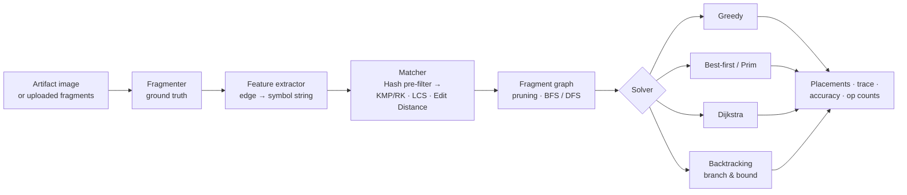
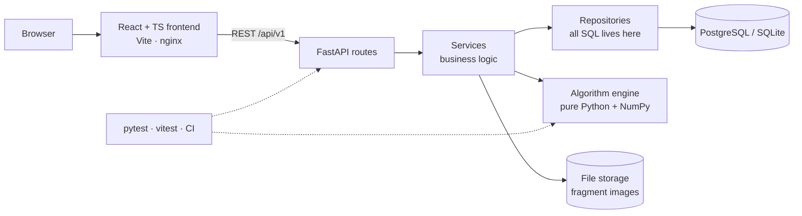

# 🏺 RELIC-X

[](https://github.com/earth-bhumi22/relic-x/actions/workflows/ci.yml)
[](backend/pyproject.toml)
[](frontend/package.json)
[](LICENSE)

**Interactive System for Reconstruction of Fragmented Cultural Artifacts.**
An ADA (Analysis and Design of Algorithms) project, Faculty of Technology, University of Delhi. CSE-B, Semester III.

Archaeological artifacts come back from the ground broken, shuffled and damaged.
RELIC-X is a web-based **algorithm laboratory** that reassembles 2-D fragments
using *classical, explainable* algorithms (string matching, dynamic programming,
hashing, graph search, greedy, shortest paths and backtracking) and shows
**why** every piece was placed where it was.

It answers two questions:

1. **What reconstruction did we get?** Fragments are scored pairwise, turned into a
   weighted graph, and assembled by a choice of four solvers.
2. **Why did the algorithm put these two pieces together?** Every join can be broken
   down into its LCS, edit-distance, motif (KMP / Rabin-Karp), hash and colour scores,
   and every solver decision is replayable as a step-by-step trace.

---

## ⚠️ Read this before you demo anything

- **Accuracy numbers are on synthetic fragments.** Artifacts are cut from a known
  image so the true arrangement is available for measurement (synopsis §6). Real
  fragments can be uploaded and reconstructed, but no accuracy can be reported for them
  because there is no ground truth.
- **Backtracking is exponential.** It runs branch-and-bound with a node limit. When
  the limit is hit, the run is marked `truncated` and returns the best arrangement
  found. That is expected behaviour, and the scaling chart is built to show it.
- **Periodic patterns are genuinely ambiguous.** If an image repeats exactly at the cut
  spacing, several arrangements are equally valid for *any* algorithm. The bundled
  samples are drawn to avoid this.
- **Fragments are square grid tiles** in this version (rotation in 90° steps).
  Free-form contours and 3-D point clouds are future work; see
  [`planning/ARCHITECTURE.md`](planning/ARCHITECTURE.md) §Scope.

---

## 🧭 How it works



Each fragment edge is read **clockwise** as a strip of pixels, resampled and
quantised into a symbol string such as `AAQQRbbcc…`. Two pieces fit when one
edge reads like the other edge reversed, which turns a picture problem into a
string problem.

| Stage | Technique | Complexity | ADA topic |
|---|---|---|---|
| Pre-filter | n-gram rolling-hash signatures + Jaccard | O(L) per edge | Hashing |
| Motif | Longest shared run: binary search + **KMP** or **Rabin-Karp** | O(log L · L²) / O(log L · L) exp. | String matching |
| Similarity | **LCS** (two-row DP) | O(L²) time, O(L) space | Dynamic programming |
| Damage cost | **Edit distance** (two-row DP) | O(L²) time, O(L) space | Dynamic programming |
| Groups | **BFS / DFS** connected components | O(V + E) | Graph traversal |
| Assembly | **Greedy** frontier placement | O(n³) | Greedy-choice property |
| Assembly | **Best-first** (Prim, max-heap) | O(E log E) | Priority queues, MST |
| Assembly | **Dijkstra** shortest-path tree | O((V+E) log V) | Shortest paths |
| Assembly | **Backtracking** + branch & bound | O((n·R)ⁿ) worst | State-space search |

Full derivations, recurrences and measured results are in [`docs/ALGORITHMS.md`](docs/ALGORITHMS.md).

---

## 🏗️ System architecture



**Layering rules**

- The frontend talks only to `/api/v1`; it never touches the database or files.
- Routes contain no logic: they validate input (Pydantic) and call one service.
- Services orchestrate repositories and the engine and raise *domain* errors, never HTTP errors.
- Only repositories build SQL queries.
- **The engine imports nothing from the web or DB layers.** This is enforced by
  `backend/tests/engine/test_engine_purity.py`, so every algorithm can be tested and
  benchmarked on its own.
- Integrity rules (sides 0–3, scores in [0, 1], one fragment per cell, no self-joins)
  are `CHECK` / `UNIQUE` constraints in the schema, not only Python checks.

---

## 📁 Repository layout

```text
relic-x/
├── backend/                  # Python package `relicx`
│   ├── src/relicx/
│   │   ├── engine/           # ★ algorithms: strings/, solvers/, matcher, graph, metrics
│   │   ├── api/              # FastAPI routes, dependencies, presenters
│   │   ├── services/         # business logic, storage
│   │   ├── repositories/     # data access (SQLAlchemy)
│   │   ├── db/               # ORM models, session
│   │   ├── schemas/          # request/response models = API contract
│   │   └── core/             # config, errors, logging
│   ├── migrations/           # Alembic
│   └── tests/                # engine/ (unit) · api/ (HTTP) · migrations
├── frontend/                 # React + TypeScript + Vite
│   └── src/                  # pages/ · components/ · api/ · hooks/ · types/
├── validation/               # reproducible benchmark + accuracy experiments
├── datasets/                 # sample artifacts and how they are generated
├── docs/                     # ALGORITHMS.md · API.md · VIVA_NOTES.md
├── planning/                 # ARCHITECTURE · TEAM_ROLES · CONTRACT · WORKFLOW
├── .github/                  # CI, CodeQL, dependabot, templates, CODEOWNERS
└── docker-compose.yml        # postgres → migrate → api → web
```

| Folder | Owner | Notes |
|---|---|---|
| `backend/src/relicx/engine/strings/` | B | KMP, Rabin-Karp, LCS, edit distance, hashing |
| `backend/src/relicx/engine/solvers/`, `graph.py` | A | Greedy, best-first, Dijkstra, backtracking, BFS/DFS |
| `backend/src/relicx/{api,services,repositories,db}` | A | API, persistence, DevOps |
| `frontend/` | B | All UI |
| `validation/`, `docs/` | A + B | Each documents their own algorithms |

Team key and full responsibilities: [`planning/TEAM_ROLES.md`](planning/TEAM_ROLES.md).

---

## 🚀 Quick start

### Option 1: Docker (whole stack, one command)

```bash
cp .env.example .env
docker compose up -d --build
```

| Service | URL |
|---|---|
| Web app | http://localhost:8080 |
| API | http://localhost:8000 |
| API docs (Swagger) | http://localhost:8000/docs |

### Option 2: Local development

**Backend** (Python 3.11+). SQLite and local storage, no setup needed:

```bash
cd backend
python -m venv .venv && source .venv/bin/activate     # Windows: .venv\Scripts\activate
pip install -e ".[api,dev]"
uvicorn relicx.main:app --reload                       # http://localhost:8000/docs
```

**Frontend** (Node 20+):

```bash
cd frontend
npm install
npm run dev                                            # http://localhost:5173
```

### Run the tests

```bash
cd backend && pytest            # engine + API + migration tests
ruff check . && black --check .
cd ../frontend && npm test && npm run build
```

---

## 🖥️ What you can do in the app

| Screen | What it shows |
|---|---|
| **Projects** | Artifact cards: fragment count, best accuracy, last run |
| **Fragment gallery** | Scrambled pieces; click one to see its 4 edge strings as colour beads |
| **Similarity graph** | Fragments as nodes, joins as weighted edges; threshold / top-k pruning live; BFS vs DFS components |
| **Why matched?** | For any edge: LCS alignment, edit operations, shared motif, hash overlap, weighted score breakdown |
| **Reconstruction** | Animated assembly, confidence per piece, step-by-step trace playback, ground-truth overlay |
| **Lab / Benchmark** | All solvers side by side: time, operation counts, score, accuracy; time-vs-n scaling chart; CSV export |

---

## 🔌 API at a glance

Base path `/api/v1`. The full contract is in [`planning/CONTRACT.md`](planning/CONTRACT.md); live docs are at `/docs`.

| Method | Endpoint | Purpose |
|---|---|---|
| `GET` | `/health` | Liveness + DB check |
| `GET` | `/samples` | Built-in demo artifacts |
| `POST` | `/artifacts/sample` · `/artifacts/upload` · `/artifacts/fragments-upload` | Create an artifact |
| `POST` | `/artifacts/{id}/fragment` | Re-cut with new grid / damage settings |
| `GET` | `/artifacts/{id}/fragments` | Fragment gallery |
| `POST` | `/artifacts/{id}/match` | Compute pairwise compatibility |
| `GET` | `/artifacts/{id}/graph` | Pruned graph + BFS/DFS components |
| `GET` | `/artifacts/{id}/explain` | "Why matched?" for one join |
| `POST` | `/artifacts/{id}/runs` | Run one solver |
| `POST` | `/artifacts/{id}/benchmark` | Run all solvers |
| `GET` | `/runs/{id}` | Placements + full trace |
| `POST` | `/benchmark/scaling` | Time / accuracy vs. fragment count |

Errors always have one shape: `{"error": {"code", "message", "details"}}`.

---

## 📊 Measured results (synthetic, 4×4 to 6×6, noise + edge erosion)

Reproduce with `python validation/run_benchmarks.py`. Typical findings:

- **Greedy** is the most accurate on most inputs, because it scores each candidate against *all* placed neighbours.
- **Backtracking** (seeded with greedy as its starting best solution) never scores worse than greedy and fixes some of greedy's early mistakes, at roughly 100× the time.
- **Best-first (Prim)** is the fastest and is accurate when joins are distinctive.
- **Dijkstra** is the weakest. Summing costs along paths is the wrong objective for assembly, which makes it a useful comparison point in the report.

Exact tables are generated into [`validation/results.md`](validation/results.md).

---

## 📚 Documentation

| Document | Contents |
|---|---|
| [`planning/ARCHITECTURE.md`](planning/ARCHITECTURE.md) | Layers, ER diagram, data flow, scope, design decisions |
| [`planning/TEAM_ROLES.md`](planning/TEAM_ROLES.md) | Who owns what |
| [`planning/CONTRACT.md`](planning/CONTRACT.md) | API contract between frontend and backend |
| [`planning/WORKFLOW.md`](planning/WORKFLOW.md) | Branching, PRs, reviews, CI |
| [`docs/ALGORITHMS.md`](docs/ALGORITHMS.md) | Recurrences, proofs sketches, complexity, measured counts |
| [`docs/VIVA_NOTES.md`](docs/VIVA_NOTES.md) | Likely viva questions with short answers |
| [`CONTRIBUTING.md`](CONTRIBUTING.md) · [`SECURITY.md`](SECURITY.md) · [`CHANGELOG.md`](CHANGELOG.md) | Project hygiene |

---

## 👥 Team

| | Member | Roll No. |
|---|---|---|
| **A** | Arvind Kaushik | 25293916019 |
| **B** | Bhumi Kansal | 25293916026 |

Submitted to **Dr. Juhi Jain**, Analysis and Design of Algorithms.

## 📖 References

1. RePAIR Project, *The RePAIR Dataset and Benchmark for Real-World 2D and 3D Archaeological Fragment Reassembly.* https://repairproject.github.io/
2. Zhang, K. et al., *3D Fragment Reassembly Using Integrated Fracture-Region Matching.* ICCV 2015.
3. Cormen, Leiserson, Rivest, Stein, *Introduction to Algorithms*, 4th ed. (KMP, LCS, Dijkstra, Prim).

## License

[MIT](LICENSE)
