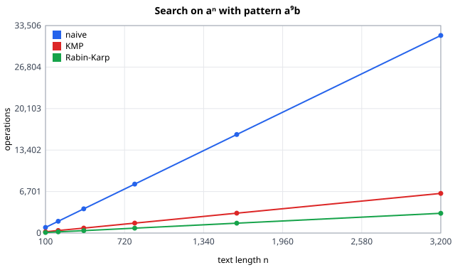
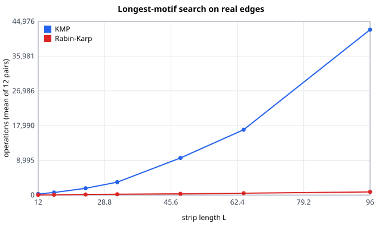
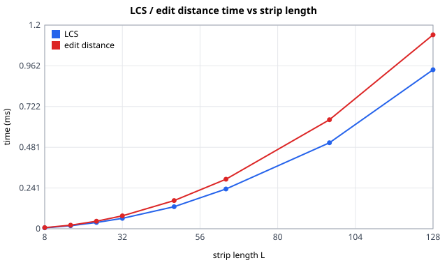
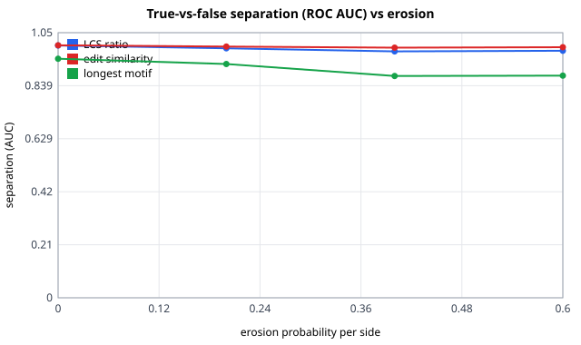

# RELIC-X — Algorithms

Each algorithm gets the same structure: **idea → recurrence / pseudocode → correctness →
time and space complexity → measured behaviour → where it shows in the app**. Each owner
fills their own slice's sections (TEAM_ROLES §1, DSA quota items 3 and 4).

| Slice | Owner | Issue |
|---|---|---|
| Strings & Matching | **B — Bhumi** | T40 (writes up T10 – T13) |
| Graph & Search | **A — Arvind** | T43 (writes up T14 – T17) |

---

## 0. Problem formulation (shared)

Given fragments F = {f₁ … fₙ}, each a square tile with 4 sides (N, E, S, W read clockwise), find
a placement `(row, col, rot)` for each fragment on an R × C grid that maximises

    Σ over adjacent pairs (i, j) of compat(i, side facing j, j, side facing i)

where `compat ∈ [0, 1]` comes from the matcher. Without rotation the search space is n!
arrangements; with rotation it is n! · 4ⁿ.

---

# Part I — Strings & Matching (owner: B)

## 1. Edge features (`engine/features.py`)
<!-- T13: clockwise reading convention and why it makes "compare with reversed" rotation-proof; resampling; quantisation into 64 symbols. -->

## 2. KMP (`engine/strings/kmp.py`)
**Problem.** Find every occurrence of a pattern P (length m) in a text T (length n). In RELIC-X both are edge strings
over a 64-symbol alphabet; KMP is the decision step of the longest-motif search (§4).

**Prefix function.** π[i] = length of the longest *proper* prefix of P[0..i] that is also a suffix of P[0..i]
(its longest "border"). Example: `ababaca` → `[0, 0, 1, 2, 3, 0, 1]`. Computed incrementally: with k = π[i−1],
compare P[i] with P[k]; on a match π[i] = k + 1, on a mismatch fall back k ← π[k−1] (the next-longest border) and
compare again, until k = 0. Correctness: every border of P[0..i] is a border of P[0..i−1] extended by one character,
and the borders of P[0..i−1] are exactly k, π[k−1], π[π[k−1]−1], …, so trying them longest-first finds the longest one.

**Search.** Keep k = number of pattern characters matched so far. For each text character: compare T[i] with P[k];
on a match k ← k + 1 (if k = m, report i − m + 1 and set k ← π[m−1] so overlapping occurrences are found); on a
mismatch with k > 0 fall back k ← π[k−1] and compare T[i] again. **The text index never moves backwards**, which is
the whole difference from the naive matcher.

**Time (amortised, exact bound).** Every comparison either *advances* (a match: k grows by 1) or *falls back* (a
mismatch with k > 0: k strictly shrinks). k starts at 0 and never goes below 0, so the number of fall-backs is at
most the number of earlier matches. Each text position ends with exactly one final comparison. Hence

- search: ≤ n final comparisons + ≤ n − 1 fall-backs = **≤ 2n − 1** comparisons → O(n);
- prefix function: ≤ (m − 1) + (m − 2) = **≤ 2m − 3** (m ≥ 2) → O(m);
- total **O(n + m)** time, **O(m)** space (the table). Worst *and* best case are linear; there is no bad input.

The implementation counts every comparison exactly once (`char_comparisons`), and the tests assert these exact
bounds on adversarial inputs (`aⁿ` vs `a⁹b`, Fibonacci words, all-hit texts) in
`tests/engine/test_kmp_rabin_karp_motif.py`.

**Measured** (`validation/matcher_results.md`, T10): on `aⁿ` with `a⁹b` KMP uses 2n + 8 comparisons, within 8 of the
bound, and grows as n^0.99 (R² 1.0000). The naive matcher also grows linearly here but does ≈ m·n = 10n comparisons
(5× KMP at n = 3200); its gap grows with m, and its true worst case is Θ(n·m).

## 3. Rabin-Karp (`engine/strings/rabin_karp.py`)
**Idea.** Compare *fingerprints* instead of strings. The polynomial hash of a window w₀…w_{m−1} is
h = (w₀·B^{m−1} + w₁·B^{m−2} + … + w_{m−1}) mod M with B = 257, M = 10⁹ + 7. Sliding the window one step is O(1):

    h' = ((h − w_out · B^{m−1}) · B + w_in) mod M        (B^{m−1} mod M precomputed once)

**Algorithm.** Hash P once; roll over every window of T; when a window hash equals P's hash, **verify** character by
character (a hash match may be a *collision*, counted as `spurious_hits`).

**Time.** Hashing P and the first window O(m); n − m rolling steps O(1) each; each verification O(m).
- *Expected* (few collisions): **O(n + m)**. For a fixed window that does not match, the chance of a collision is
  about 1/M ≈ 10⁻⁹, so over n windows the expected number of spurious verifications is ≈ n/M ≈ 0.
- *Worst case*: every window collides → (n − m + 1) verifications of m characters → **O(n·m)**. The test sets
  M = 1 to force this and checks exactly (n − m + 1)·m comparisons; with M = 7 it checks that results stay correct
  despite many spurious hits, which shows why the verification step cannot be skipped.

**Space** O(1) beyond the input. **In RELIC-X** the same rolling hash also builds the n-gram signatures of §7 and the
decision step of the motif search (§4), where hashing all windows of one string into a set turns "does any length-L
window of A occur in B?" into one O(n + m) pass.

**KMP vs Rabin-Karp.** Both are linear in practice. KMP's bound is deterministic and needs no arithmetic;
Rabin-Karp's is expected-case, but it generalises: one pass can test *many* patterns against a hash set, which is
exactly what the motif search needs.

## 4. Longest shared motif (`engine/strings/motif.py`)
**Problem.** Given edge A and reversed edge B (each of length L), find the longest contiguous run of A that occurs
somewhere in B (the longest common *substring*). A long shared run is strong evidence that two edges continue the same
painted band or motif. Runs shorter than `min_motif` (default 3) are treated as noise.

**Monotonicity → binary search.** Let S(ℓ) = "some length-ℓ window of A occurs in B". If S(ℓ) holds, then S(ℓ − 1)
holds too (drop the last character of the shared run). So S is `True…True False…False` over ℓ = 1…L, and the
largest ℓ with S(ℓ) can be found by **binary search** with O(log L) evaluations of S instead of L. The test
`test_shared_runs_are_monotone` checks this property on random strings, and `test_motif_length_matches_brute_force`
compares the result with an O(L³) brute force.

**Decision step S(ℓ), two implementations:**
- **KMP:** for each of the L − ℓ + 1 windows of A, run KMP over B: O(L · (L + ℓ)) = O(L²) per step →
  **O(L² log L)** total.
- **Rabin-Karp:** hash every length-ℓ window of B into a set (O(L)), then probe with A's windows (O(L)), verifying
  hash hits → **O(L log L)** expected total.

**Measured** (12 truly adjacent edge pairs of the pottery sample, L = 12…96): KMP grows as L^2.38, Rabin-Karp as
L^1.31; both always return the same motif. At the default L = 24 Rabin-Karp needs ≈ 12× fewer operations, at
L = 96 ≈ 52× fewer. KMP stays the default for its deterministic worst case, and the motif step is a small part of
matching at L = 24. `MatchParams.motif_method = "rabin_karp"` switches the method; matching scores are identical
either way (tested).

## 5. LCS (`engine/strings/lcs.py`)
**Problem.** The longest common *subsequence* of edge A and reversed edge B: the longest sequence of symbols that
appears in both in the same order, not necessarily contiguously. A chipped or noisy pixel deletes or changes one
symbol; LCS simply skips it, so it measures shared *structure* while tolerating gaps.

**Recurrence.** Let L[i][j] = LCS length of A[0..i) and B[0..j).

    L[i][0] = L[0][j] = 0
    L[i][j] = L[i−1][j−1] + 1                    if A[i−1] = B[j−1]
    L[i][j] = max(L[i−1][j], L[i][j−1])          otherwise

**Optimal substructure.** If the last characters match, some LCS ends with that character (exchange argument: any LCS
not using A[i−1] can swap its last matched character for it), so L[i][j] = L[i−1][j−1] + 1. If they differ, an LCS cannot
use both, so it is an LCS of the problem with one of them dropped, the larger of the two. The subproblems overlap
(L[i−1][j−1] is reused by three cells), which is why DP beats plain recursion's exponential time.

**Time / space.** (m + 1)(n + 1) table cells, O(1) each → **Θ(m·n)** time, best = worst case. Row i only reads row
i − 1, so `lcs_length` keeps **two rows** of length min(m, n) + 1 (it swaps the arguments so the shorter string
indexes the row) → **O(min(m, n))** space. `lcs_alignment` (one pair at a time, for "Why matched?") keeps the full
table and traces back from (m, n): diagonal on a match, otherwise towards the larger neighbour. It returns the matched
index pairs, which are strictly increasing in both strings (tested).

**Score.** `lcs_ratio = LCS / max(m, n)` ∈ [0, 1]. Tests check symmetry, 0 ≤ LCS ≤ min(m, n), LCS(a, a) = |a|, a common
last character extends the LCS by one, and agreement with a brute force over all subsequences.

## 6. Edit distance (`engine/strings/edit_distance.py`)
**Problem.** The minimum number of single-symbol insertions, deletions and substitutions turning A into B
(Levenshtein distance), read as "how much damage separates these two edges".

**Recurrence.** D[i][j] = distance between A[0..i) and B[0..j).

    D[i][0] = i,  D[0][j] = j
    D[i][j] = D[i−1][j−1]                                     if A[i−1] = B[j−1]
    D[i][j] = 1 + min(D[i−1][j], D[i][j−1], D[i−1][j−1])      otherwise   (delete, insert, substitute)

On a match the code takes the diagonal directly without the min. That is safe because neighbouring cells differ by
at most 1 (|D[i][j] − D[i−1][j]| ≤ 1), so D[i−1][j−1] ≤ D[i−1][j] + 1 and D[i−1][j−1] ≤ D[i][j−1] + 1.

**Time / space.** Same shape as LCS: **Θ(m·n)** time, **O(min(m, n))** space with two rows. `edit_alignment` keeps the
full table and returns the operation script (match / sub / ins / del) for the "Why matched?" panel.

**Properties (tested on random strings).** It is a metric: D(a, a) = 0, D(a, b) = 0 only if a = b, symmetry, and the
triangle inequality. |m − n| ≤ D ≤ max(m, n). D ≤ m + n − 2·LCS: deleting everything outside an LCS and inserting
the rest is one valid script, and substitutions can only shorten it. Applying the returned script to A yields exactly
B, and its cost equals the distance. A plain recursion (no memo) agrees on small inputs.

**Score.** `edit_similarity = 1 − D / max(m, n)` ∈ [0, 1].

**Measured** (`validation/matcher_results.md`, T11). The DP counter shows exactly L² cells; time grows as L^1.89 /
L^1.90 (constant overheads flatten the smallest sizes). On all three samples (4×4, noise σ = 4) the scores separate the
72 truly adjacent edge pairs from the 1 368 wrong opposite-side pairs with ROC AUC 0.998 (LCS) and 0.999 (edit) on
clean edges, still 0.977 and 0.991 at 60 % erosion. The contiguous motif drops to 0.879: one chipped segment
breaks a run, while the DP scores only lose a few symbols. That is the case for combining them (§8).

## 6. Edit distance (`engine/strings/edit_distance.py`)
<!-- T11: recurrence, operation script, interpretation as "damage cost". -->

## 7. Hashing pre-filter and memo cache (`engine/strings/hashing.py`, `matcher.py`)
<!-- T12: n-gram signatures, Jaccard, top-k survivors; P·L + P'·L² instead of P·L²; cache hit rate. -->

## 8. Composite matcher (`engine/matcher.py`)
<!-- T13: weights, weight-sweep experiment, accuracy vs noise/erosion (from T31). -->

---

# Part II — Graph & Search (owner: A)

## 9. Fragment graph, pruning, BFS / DFS (`engine/graph.py`)
**Model.** G = (V, E): V are fragments; an undirected edge {u, v} exists when some side of u matched some side
of v well enough. Its weight is the best composite score over all side pairings of that pair, and the winning
side pair is kept (CONTRACT side numbers 0=N 1=E 2=S 3=W). `FragmentGraph.edges` lists each undirected edge once
as (u < v), sorted, so E is never double counted.

**Build.** `build_graph(nodes, matches, threshold, top_k)`:
1. Scan the M side matches once. Drop self-matches and any with composite `< threshold` (equal is kept). Keep the
   best match per unordered pair; ties go to the smaller side numbers so input order never matters. O(M) time.
2. If `top_k` is set, every node ranks its incident edges by (weight desc, neighbour id) and votes for its top k.
   An edge survives only if **both** endpoints voted for it ("best buddies"), so each edge is counted once, however
   many sides matched. Sorting costs Σ deg(v) log deg(v) ≤ 2E log E. `top_k < 1` raises `ValueError` (the old
   `if top_k:` silently treated 0 as "no pruning").
Total: O(M) without top-k, O(M + E log E) with it; space O(V + E) for the adjacency maps.

**Why mutual top-k shrinks the graph.** Each node casts at most k votes, so there are at most kV votes, and an
edge needs two: **E ≤ k·V/2**. Plain top-k ("either endpoint voted") only guarantees E ≤ kV and keeps a hub's
spurious edges because a *different* node chose it. Measured on the 5×5 samples (`validation/results.md`):
for k = 3 the bound is 37 edges and the graphs have 24–30, down from 231–236 unpruned.

**BFS / DFS** (`bfs_components`, `dfs_components`). Both start from the sorted node ids, visit neighbours
strongest-first (weight desc, id asc) and return (components, visit order). Every node is marked once and every
adjacency entry is scanned once, i.e. 2E `edge_visits`; sorting each neighbour list adds Σ deg log deg, so the
honest bound is **O(V + E + Σ deg log deg) = O(V + E log E) time**, which is O(V + E) when degrees are bounded
(as after top-k, where deg ≤ k). Extra space: BFS queue O(V); DFS stack O(E) (below).
- **Same components, different order.** A component is the set reachable from its start node; both traversals
  explore exactly that set, so the partition is identical (tested against a union-find oracle). They differ only in
  *when* a node is reached: BFS by hop distance (layers, so it gives fewest-hops paths), DFS by following one strong
  chain as deep as possible. Prefer BFS when distance/levels matter or the graph is deep; DFS when you want to commit
  to the strongest chain first (as backtracking does) and the memory use is acceptable.
- **DFS is iterative.** A path of 5,000 fragments would overflow Python's recursion limit. The stack version marks a
  node *when popped* and pushes neighbours weakest-first so the strongest pops first; this reproduces recursive DFS
  order exactly (tested), unlike the "mark on push" variant. The price: a node can sit on the stack once per incident
  edge, so the peak is O(E), not O(V). Measured: K64 peaks at 1,954 entries (97% of E) while the BFS queue peaks at 63.

**Measured** (seeded, `validation/results.md`): `edge_visits` = 2E exactly (slope 2.000, R² 1.0000 against E);
time against V + E fits a line with R² 0.996 (BFS) and 0.997 (DFS), ≈ 0.35–0.38 s per 10⁶ (V + E) on this machine.
Against V + E alone the operation count has R² 0.983, not 1, because its true coefficient is 2E, i.e. it depends on
the E/V ratio of each graph.

## 10. Greedy (`engine/solvers/greedy.py`)
**Rule.** Place the seed (the fragment whose four sides have the largest sum of best match weights; with all-zero
scores the smallest id) at (0, 0). Then, n − 1 times, look at every frontier cell c, every unplaced fragment f and
every allowed rotation r, score it as s(f, c, r) = Σ compat over the already-placed neighbours of c, and commit the
maximum (ties: more placed neighbours, then first in the order cell, id, rotation). Placements are never undone. The
greedy step reads the full `compat` table, **not** the pruned graph, so threshold / top-k do not affect it.

**Greedy-choice property: what holds and what does not.** Each step is locally optimal by construction: the committed
triple has the highest score among all candidates *for the current layout*. For this to give a global optimum we would
need (a) the greedy-choice property, i.e. some optimal layout contains the committed placement, and (b) optimal
substructure, i.e. what remains is the same problem on the rest. Neither holds: a placement fixes a fragment's cell
*and* rotation, which constrains every later neighbour, and the objective (sum over all adjacent pairs of the final
layout) rewards two medium joins more than one strong join, whereas greedy compares them one at a time. An exchange
argument fails because swapping the strongest join into an optimal layout moves its other neighbours.

**Counterexample (2×2, no rotation, fragments A–D).** Only five compat entries are non-zero (b is right of a means
side E of a matches side W of b; b is below a means side S of a matches side N of b):

| pair | relation | weight |
|---|---|---|
| C, B | B below C | 0.85 |
| D, C | C below D | 0.80 |
| D, A | A right of D | 0.60 |
| B, A | A right of B | 0.15 |
| D, A | A below D | 0.05 |

Seed: C (best sides 0.85 + 0.80 = 1.65, the largest sum). Step 1 commits the strongest join, B below C (0.85). Step 2: A
right of B (0.15) is the best remaining score. Step 3: D must go top right, above A (0.05); nothing else is left.
Greedy layout `C D / B A`, total 0.85 + 0.15 + 0.05 = **1.05**. The optimum is `D A / C B` (D over C 0.80, A right of D
0.60) = **1.40**, which never uses the 0.85 join: one strong join beats two medium ones locally, but the two medium ones
add up to more. Best-first falls into the same trap (it also takes 0.85 first, 1.05); backtracking finds 1.40. The same
instance is `COUNTEREXAMPLE` in `tests/engine/test_greedy_best_first.py` and a row in `validation/results.md`.
Exhaustive search over random 2×2 / 2×3 tables (results.md) shows greedy reaches the optimum in 48% / 25% of cases and
best-first in 33% / 10%.

**Time.** Let t fragments be placed. The frontier has F_t ≤ 4t cells, there are n − t unplaced fragments, R rotations
(1 or 4) and each `placement_score` does at most 4 lookups, so the step costs ≤ 4·R·F_t·(n − t) ≤ 16·R·t·(n − t) lookups
and the total is at most 16·R·Σ t(n − t) = 16·R·(n³ − n)/6 = **O(R·n³)**. Best case (a 1×n strip, F_t ≤ 2) is O(R·n²).
Computing the frontier costs O(t) per fit check and O(t²) per step (`Layout.bbox` is recomputed), which is O(n³) in
total and does not change the bound. **Space** O(n) for the layout and the unplaced list (plus the capped trace).
*In practice* the frontier of a compact blob is about its perimeter, F_t ≈ √t, giving about n^2.5·R. Measured on the
damaged 3×3…8×8 runs (`validation/results.md`): `score_lookups` grows as n^2.62 (R² 0.9998), wall time as about n^2.3;
profiling the 8×8 case shows `placement_score` and the lookups it makes take most of the time, the frontier little.
The cubic bound is a worst case that the grid shape prevents.

**Space of the result, determinism.** Everything is deterministic: candidates are iterated in sorted order and ties
use a strict `>`. A fragment that fits nowhere (grid too small) is reported in `meta["unplaced"]` and a `stop` trace
step is written.

## 11. Best-first / Prim (`engine/solvers/best_first.py`)
**Algorithm.** Prim's algorithm on the fragment graph with a max-heap of joins `(−weight, u, v)`, u placed, v not yet:
pop the strongest; if v is already placed skip it (lazy deletion); otherwise take the direction
d = (side_u + rot_u) mod 4 that u's joining side faces, put v in the neighbouring cell and rotate it by
rot_v = (d + 2 − side_v) mod 4 so its joining side faces back (the convention of `layout.py`: side s faces
(s + rot) mod 4). If rotation is disabled and rot_v ≠ 0, or the cell is occupied or outside the grid, record a
`conflict` and drop the join; else place v and push its edges to unplaced fragments. Fragments no join attached go to
their best free slot (`fallback`). Heap tuples are `(−weight, id_u, id_v)`, so ties are broken by ids and the order is
deterministic; ids are strings, so no two entries ever compare anything but tuples of comparable fields.

**Time and space.** An undirected edge {a, b} is pushed only by the endpoint committed first (the other sees its
partner already placed), so **pushes ≤ E** (the loose bound 2E counts both directions) and pops ≤ pushes. A heap
operation costs O(log E), so heap work is **O(E log E)**; each pop also tests the target cell with `Layout.fits`, which
rebuilds the bounding box in O(t), giving O(E·n) in the worst case, plus O(U·F·R) for the U unattached fragments, whose
fallback scans the frontier. Space O(E) for the heap and O(V) for the layout. Lazy deletion is preferred to
decrease-key because a binary heap cannot find an entry to update: we simply push every join once and discard stale
ones on pop (each costs one O(log E) pop), which is simpler and keeps O(log E) per operation. Measured (damaged
runs, `validation/results.md`): pushes equal E up to the few fragments placed by fallback (e.g. 233 pushes for E = 233
at n = 25), and since this matcher's graph grows as E ≈ n^1.6 the push count grows with exponent 1.58
(R² 0.9917), time with about 1.7. With a mutual top-3 graph the heap work is tiny (about 40 pushes at n = 64) but the
time exponent rises to about 2.1 because the unattached fragments are then placed one by one by `fallback`, and accuracy
drops (46% against 57% on the full graph at n = 64).

**Relation to maximum spanning trees.** Prim grows a tree from the seed by always adding the heaviest edge crossing
the cut (placed | unplaced). By the cut property the heaviest edge crossing any cut belongs to some maximum spanning
tree, so if **every** pop that reaches an unplaced vertex is accepted, the joins committed form a maximum spanning tree
of the seed's component (unique when weights are distinct). The tests check this against a Kruskal oracle, both on a
clean strip and on random graphs: the join sets are equal unless a `conflict`, `fallback` or `stop` is recorded. Placement breaks
the equivalence in exactly two places: (1) a conflict (cell occupied, outside the grid, or a rotation that is not
allowed) discards the edge, so the result is no longer a spanning tree of the graph. Dropping it for good loses
nothing: occupied cells stay occupied, the bounding box only grows, and rot_v is fixed by u's placement, so the same join
could never succeed later; the fragment may still be attached through another, weaker join. (2) pruned or unattached fragments
are placed by `fallback`, which ignores the graph. Also, the heap key is the weight of the *single* join; the score of
the result sums every adjacency in the grid, so a spanning tree is not even the same objective.

**Why it differs from greedy.** Best-first looks only at the single strongest join, in O(E log E); greedy scores each
candidate cell against **all** its placed neighbours, so it sees closed loops (a piece fitting two sides at once) at
a cost of O(R·n³). Hence best-first needs the (prunable) graph, is much faster (about 1.4 ms against 21 ms at n = 64 clean)
and is less accurate on average (e.g. 73% against 81% clean at n = 64). Both share the weakness shown in §10.

## 12. Dijkstra (`engine/solvers/dijkstra.py`)
**What it computes.** Dijkstra from the seed on the fragment graph with edge cost c(u, v) = 1 − w(u, v), where w is the
join weight (a composite score in [0, 1], CONTRACT §2). It returns the cost `dist` of the cheapest path from the seed to
every reachable fragment and a `parent` pointer for each, i.e. a **shortest-path tree**. `solve_dijkstra` then places
fragments in settle order, each in the cell its parent join dictates (d = (side_u + rot_parent) mod 4, rot =
(d + 2 − side_v) mod 4); a taken or out-of-bounds cell, a forbidden rotation or an unreachable fragment goes to
`_fallback` (best free frontier slot, shared with best-first) and is logged as a `conflict`.

**Non-negativity.** The matcher's composite is a weighted average of terms in [0, 1], so w ∈ [0, 1] and c ≥ 0.
`build_graph` itself does not enforce this, so `edge_cost` clamps to `max(0, 1 − w)`. A clamp was chosen over an
assertion because a weight of 1.0000001 (float noise) or a custom matcher should degrade gracefully, not return a 500;
only w > 1 can break the precondition (w < 0 only gives a cost above 1, which is still legal).

**Correctness sketch.** Invariant: when a node u is settled (popped with a non-stale entry), `dist[u]` is the length of a
shortest seed → u path. Proof by induction on the settle order. Suppose u is the first node settled with
`dist[u]` greater than the true distance δ(u). Take a shortest seed → u path and its first node y not yet settled; its
predecessor x is settled, so by induction `dist[x] = δ(x)` and relaxing the edge (x, y) gave `dist[y] ≤ δ(x) + c(x, y) =
δ(y)`. Because every cost is ≥ 0, δ(y) ≤ δ(u) along the path, so `dist[y] ≤ δ(y) ≤ δ(u) < dist[u]`. But u was popped
before y, so `dist[u] ≤ dist[y]`: contradiction. **Non-negativity is used in the step δ(y) ≤ δ(u)**: with a negative edge
a later node could still lower an already settled distance, settled values would not be final and the algorithm would
be wrong (it would need Bellman-Ford). Lazy deletion instead of decrease-key: a node may be pushed once per improving
relaxation and a stale entry (node already settled) is discarded on pop, which keeps a plain binary heap and O(log E)
per operation. Ties: heap entries are `(dist, id)` and an exactly equal-cost alternative keeps the smaller-id parent
(never re-parenting a settled node), so the tree does not depend on the order of the adjacency lists; costs differing
only by float rounding are not treated as ties. The settle order starts with the seed (the only initial heap entry), and
a parent is recorded only while relaxing from a settled node, so every parent is settled, hence already placed, before
its child.

**Time and space.** Each settled node scans its adjacency list once: relaxations = Σ deg = 2E exactly, and heap pushes
are at most the number of improving relaxations, so the heap holds at most E entries and log E = O(log V). Total
**O((V + E) log V)** (worst case, many improving relaxations); best case O(V + E) (every node is reached once through
its cheapest edge, e.g. a path). Space O(V + E). The placement step adds **O(U·F·R)** for the U conflict or unreachable
fallbacks, each scanning F ≤ 4t frontier cells and R rotations. Measured (damaged 3×3…8×8, `validation/results.md`):
relaxations equal 2E exactly (ratio 1.00 at every n) and grow as n^1.58 like E itself, `heap_pops` as n^1.18 (0.13–0.30 of
E, the rest of the pushes are never needed), but the number of conflicts grows roughly linearly with n (16 per run at
n = 25, 49 at n = 64) so `score_lookups` from the fallbacks grow as n^2.06 against n^1.58 for the heap work (wall time about n^2): the fallbacks,
not the heap, are what grows fastest.

**Why a path-sum objective underperforms for assembly.**
(a) A hop never costs less than 0, so cost accumulates with depth: a fragment with one excellent join to a far-away
fragment can be reached more cheaply through a nearby fragment by a mediocre join, so the tree hangs it there. (b) Path cost
measures distance from the **seed**, but where a fragment belongs depends on the **single join** to its neighbour, not on
how far it is from the seed. (c) A wrong placement propagates: a conflicting child is re-seated by `_fallback` at its actual
cell and its own children are placed relative to that cell (tested), so one error shifts a whole subtree. (d) Prim's key is the
single-edge weight, which is the quantity that matters; the closer path objective is a **bottleneck (minimax) path**, where
the cost of a path is its weakest join. Measured: on 5×5 grids the mean join weight in Dijkstra's tree is 0.517 against
0.685 for the maximum spanning tree at noise 4 / erosion 0.3, and 62% of fragments get a different parent than in the
maximum spanning tree (clean: 0.703 against 0.820, 40%); the gap widens with damage (0.285 against 0.442 at noise 32, erosion
0.6). Dijkstra has 16 conflicts per run at 25 fragments (clean: 11) and its neighbour accuracy is 38% on the full graph and
49% on the mutual top-3 graph (the API default), against 84% for best-first and 91% for greedy; at 3×3 it is 73% (full graph)
against 93% (best-first) and the gap grows with n.

**Counterexample (≤ 5 fragments; 2×2 grid, no rotation, seed A).** Fragments A, B, C with three non-zero compat entries
(b right of a means side E of a meets side W of b; b below a means side S meets side N):

| join | weight | cost 1 − w |
|---|---|---|
| B left of A | 0.25 | 0.75 |
| A below C | 0.35 | 0.65 |
| C left of B | 0.60 | 0.40 |

Dijkstra: dist(C) = 0.65 via A; dist(B) = min(0.75 via A, 0.65 + 0.40 = 1.05 via C) = 0.75, so the settle order is A, C, B
and B hangs on A by the mediocre 0.25 join. Layout `. C / B A`, total 0.35 + 0.25 = **0.60**. Prim pops the strongest
crossing edge each time: A–C (0.35), then C–B (0.60) beats A–B (0.25), giving `C B / A .` with total 0.35 + 0.60 =
**0.95**, which equals the exhaustive optimum. The same instance backs `test_dijkstra_counterexample_*` in
`tests/engine/test_dijkstra.py` and a row in `validation/results.md`.

**Things worth knowing.** `meta["conflicts"]` counts conflicts of fragments that had a parent; unreachable fragments are
counted in `meta["unreachable"]` and, like conflicts, appear as `conflict` steps in the trace (the message and the `parent`
field tell them apart), so `trace conflicts = meta conflicts + placed unreachable`. The API runs Dijkstra on the mutual
top-3 graph unless `top_k` is given, which helps it (79% against 63% clean at 25 fragments; fewer, stronger edges leave fewer
candidate parents to choose wrongly).

## 13. Backtracking + branch & bound (`engine/solvers/backtracking.py`)
**What it computes.** An exact search for the arrangement with the largest total compatibility score
`Σ w(a, s_a, b, s_b)` over all adjacent pairs, on an R × C grid with `n ≤ R·C` fragments. It fills cells in row-major
order; at each cell it tries every unused fragment in every allowed rotation, or leaves the cell `EMPTY` (only while
enough empties remain, so that every fragment still fits). A placement scores the sum of its **left** and **top**
adjacencies, so each adjacent pair is counted exactly once, when the later cell is filled. Same score convention as
`Layout.total_score`. The compat table must be symmetric (`compat_table` stores both directions).

**State space (exact).** An arrangement is an injective map from the n fragments to the C = R·C cells, plus one of R_t
rotations per fragment (R_t = 1 or 4): `C! / (C − n)! · R_t^n` arrangements. For n = C that is `n! · R_t^n` leaves. The
search tree (before any pruning) has `Σ_{k=0..n} n!/(n−k)!` nodes without rotation and `n = C`; this is the "unbounded
tree" column of the generated table (65 nodes for n = 4, 1,957 for n = 6, 9,864,101 for n = 10, 1,302,061,345 for
n = 12). Rotation multiplies each level by R_t.

**Upper bound, two lemmas.** Let `score` be the total of all adjacencies already booked (cells before k), M the largest
value in the compat table, `adj_after[k]` the number of left/top adjacencies of cells k … C−1, and `best_side(f, s)` the
largest weight any join can give side s of f. Define, per fragment, `v_best[f] = max over rotations of
best_side(f, west) + best_side(f, north)` (the two sides f contributes when it is the *later* cell of a pair).

- *Lemma 1 (adjacency bound).* Any completion adds at most `M · adj_after[k]`. Proof: only the adjacencies of cells
  ≥ k are not yet booked; there are exactly `adj_after[k]` of them and each is ≤ M. An `EMPTY` cell adds 0 ≤ M.
- *Lemma 2 (fragment bound).* Any completion adds at most `Σ_{f unused} v_best[f]`. Proof: a future gain is booked
  when its later cell is filled, and that cell holds an unused fragment f (an already-placed fragment's own gains are
  in `score`). The gain of f in its cell is `w(left, f's W side) + w(top, f's N side)` ≤ `best_side(f, W-facing
  side) + best_side(f, N-facing side)`, and the rotation can only choose which sides face W and N, so it is ≤
  `v_best[f]`. Symmetry of compat lets `best_side` be read from one direction. Unused fragments that end up in cells
  with a missing neighbour gain less, never more.

Both are valid, so is their minimum: `bound = score + min(M·adj_after[k], Σ_unused v_best)`. They are incomparable
(Lemma 1 is tight when few cells remain, Lemma 2 when few fragments remain), so the code takes the minimum.
`tests/engine/test_backtracking.py` checks both directly: for every partial arrangement of the 2×2 (with and without
rotation) and 2×3 grids it brute-forces the best completion and asserts it never exceeds either term.

**Branch and bound correctness.** Invariant: `best` is the score of a complete arrangement that exists. A node is
pruned when `bound ≤ best`; every completion below it scores `score + future ≤ bound ≤ best`, so it cannot beat the
incumbent, and dropping it keeps the optimum. Pruning on `≤` (not `<`) discards ties: the first-found layout of a given
best score is the one returned (an incumbent that is already optimal comes back unchanged, which the test asserts).
`best` starts at −1.0 so that a score-0 arrangement is accepted as the first answer; a new best must exceed the
old by more than 1e-9 so float-summation noise never produces a fake "improvement". When n < C the `EMPTY` option adds
0 and consumes one of the `C − n` allowed empties; both lemmas hold unchanged. With rotation, `v_best` maximises over
rotations and each placement tries all of them. The brute-force tests (2×2, 2×3, with and without rotation, with an
empty cell, with and without incumbent, 109 random tables in total) always agree with an exhaustive enumeration.

**Greedy starting solution.** `run_solver` runs greedy first and passes its placements as `incumbent=`. The search
scores it (`Layout.total_score`), sets `best` to that value, and so prunes from the first node. An incumbent that does not
fit the grid is ignored. It can never make the answer worse, and a truncated run returns at least the incumbent. Measured
effect on random 2×k tables (generated, 5 seeds): the incumbent saves little, because greedy is rarely close to the
optimum there and the search finds a good arrangement quickly anyway: n = 6, 945 → 878 nodes (−7 %); n = 8,
25,441 → 25,304 (−0.5 %). Where the incumbent matters is guaranteeing a floor when the limit hits (below).

**Time and space.** Worst case `O(C!/(C−n)! · R_t^n)` nodes, each costing O(n·R_t) to enumerate options and O(n) for the
fragment bound; space O(C) for the recursion plus the capped trace. It is exponential in n; the bound only shrinks the constant, not the worst case.

**Node count vs n (measured).** From the generated table (random compat tables, 2×k grid, mean over 5 seeds): 54 nodes
at n = 4, 945 at n = 6, 25,441 at n = 8 without an incumbent, against a 109,601-node unbounded tree at n = 8. Fitting
ln(nodes) on n over the three un-truncated sizes (n = 4, 6, 8) gives slope 1.540 (×4.66 per extra fragment), R² = 0.998
(with incumbent: 1.556, ×4.74, R² = 0.998). Only three points, so treat it as an indication of exponential growth, not as
a precise base. At node limit 300,000 truncation begins at **n = 10** (all 5 seeds). On the synthetic images (3×3, 4×4)
the real compat structure is far easier than random tables: n = 16 needs 1,886 nodes on average on clean images but
reaches the limit on 2 of 6 damaged instances.

**Truncation (`node_limit`).** Guarantee: the result is always a valid, complete layout, never empty, with
`score ≥` the incumbent score when one is given. The limit is enforced only once one complete arrangement exists
(the first descent needs about C + 1 nodes), so with no incumbent `nodes` can exceed `node_limit` by about that much.
This fixes a bug found in T17: previously a limit smaller than the first descent with no incumbent returned an empty
layout. A truncated run sets `truncated = True`, and the trace ends with a `limit` step. Trace cap: routine steps
(`place`, `backtrack`, `prune`) obey the 400-step cap and are counted in `trace_dropped`; the milestones `incumbent`,
`best` and `limit` use a reserved 100-slot extension (`TraceRecorder.log_important`) so they are never lost. `prune`
steps now carry `bound` and `best`.

**Dynamic-programming extension (`engine/solvers/row_dp.py`, not registered in `ALGORITHMS`).** For a grid with
exactly two rows (2 × c, K = 2c fragments) the exact optimum has a column DP. State after column j: the set of used
fragments (bitmask) and the top and bottom options (fragment, rotation) of column j. Recurrence, with H the east/west
compatibility, V the south/north compatibility of a vertical pair:
`S_{j+1}(mask ∪ {t', b'}, t', b') = max over (mask, t, b) of S_j(mask, t, b) + H(t, t') + H(b, b') + V(t', b')`.
Rotation is supported (an option is a (fragment, rotation) pair). The code splits each column into two half steps (choose
the top, then the bottom) so each state expands O(K·R) options in each half. Number of states after j columns:
`C(K, 2j) · 2j(2j−1) · R²`; for R = 1 the total over all columns matches the stored-state counts in the generated table
(24, 240, 1,792, 11,520, 67,584, 372,736 for c = 2…7). Time `O(2^K · K³ · R³)`, memory `O(2^K · K² · R²)` (back-pointers for
all layers are kept). The profile is the used-set bitmask: it is what makes the problem 2^K instead of K! — but it only
works because the "frontier" is two cells. For an R × C grid the profile would have to hold the whole boundary row (R
cells, each with a fragment and rotation) so the state count is the bitmask times (K·R_t)^R-style row profiles and the transition
cost grows with it: this does not generalise, which is why backtracking stays the general solver.
Measured (generated, random tables, density 0.35, seed 7, no rotation): the DP matches backtracking's score whenever
backtracking completes (c = 2, 3, 4), and beats the truncated backtracking at c = 5, 6, 7 (7.338 vs 6.942, 10.188 vs 9.635,
12.307 vs 11.200). DP time 214 ms at c = 6 (12 fragments, 67,584 states), 1,420 ms at c = 7, and it **stops at c = 8**
(16 fragments): the 1,500,000-state limit is exceeded (the full state count there is 1,966,080). Backtracking is
truncated at 300,000 nodes from c = 5.

**Where it is used.** `backtracking` in the API runs greedy and then branch and bound seeded with it; `meta` carries
`nodes`, `pruned`, `node_limit`, `incumbent_score`, `improved_on_incumbent`. The DP is a verification tool and a benchmark
reference (tests assert DP = exhaustive = un-truncated backtracking on 2×2, 2×3 and 2×4).

## 14. Accuracy metrics (`engine/metrics.py`)
Two metrics, both compared with the ground truth that synthetic artifacts carry (`Truth(row, col, scramble_rot)` per
fragment). Both are in [0, 1].

- **Neighbour accuracy.** Denominator: the number of true right and down adjacencies in the picture. A true adjacency
  (f, g) counts as reproduced when both fragments are placed, their *net* orientations agree (scramble rotation plus the
  solver's rotation, mod 4), and g sits next to f in the direction the net orientation implies (`_rot_vec`). It does not care
  where on the grid the pair is, so it rewards local correctness: two correct halves with a gap between them still score the
  adjacencies inside each half.
- **Direct accuracy.** Fragments in the right cell. Because a solution may be a global rotation and a shift of the true picture
  and still be correct, it tries each of the four global rotations, lets every fragment vote for the shift that would put it
  in its true cell, and takes the winning (rotation, shift) vote count divided by the number of truth fragments. It is stricter:
  one displaced fragment in the middle changes the cells of everything pushed along with it.
- **Invariance.** Both are invariant to a global shift and a global rotation of the whole layout (tests: exact layout, a
  shifted copy and a layout rotated by 90, 180, 270° all score 1.0). A mirror image is *not* a rotation: it scores below 1
  (3/7 neighbour, 2/6 direct for a mirrored 2×3 in the test).
- **Neighbour vs direct ordering.** Neither dominates. Two correct halves with a gap: neighbour 2/3 > direct 2/4. Two pieces
  swapped in a 2×2: neighbour 1/4 < direct 2/4. In the benchmark section the two are close because errors there are mostly one
  displaced fragment.
- **Missing pieces.** Denominators use the *truth*, not the layout, so an unplaced fragment is counted wrong (a 2×3 picture
  missing one top-middle piece scores 4/7 neighbour, 5/6 direct in the test).
- **No ground truth.** Uploaded artifacts have none; the functions return 1.0 for an empty truth (vacuous, to avoid dividing by
  zero). The API reports no accuracy for those runs, so 1.0 never reaches the UI; do not read it as "perfect".
- **An empty layout against a truth** scores 0 / 0.

---

## 15. Summary table (both)

| Algorithm | Time | Space | Owner |
|---|---|---|---|
| KMP | O(n + m) | O(m) | B |
| Rabin-Karp | O(n + m) expected, O(nm) worst | O(1) | B |
| LCS / Edit distance | O(mn) | O(min(m, n)) | B |
| n-gram pre-filter | O(L) per edge, O(P·L) total | O(L) | B |
| BFS / DFS | O(V + E) | O(V) | A |
| Greedy | O(n³) | O(n) | A |
| Best-first (Prim) | O(E log E) | O(E) | A |
| Dijkstra | O((V + E) log V) | O(V) | A |
| Backtracking | O((n·R)ⁿ) worst | O(n) | A |
