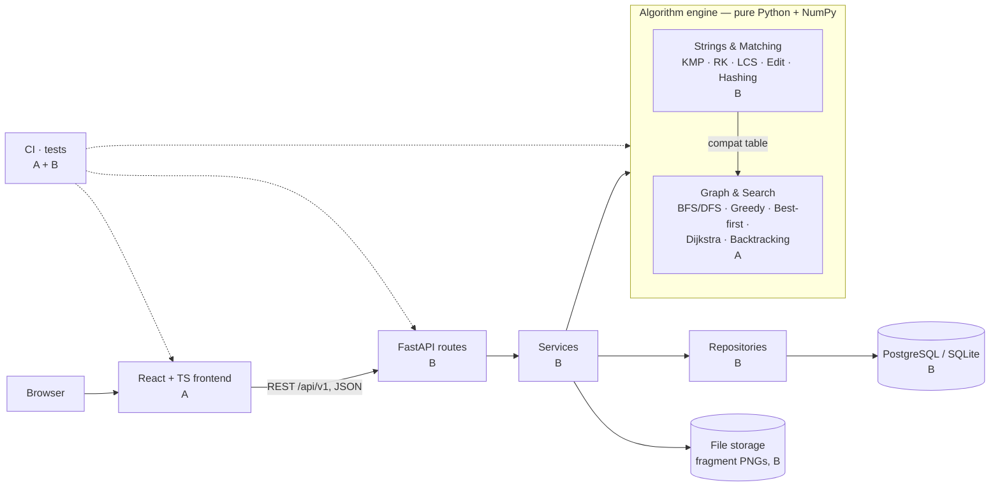
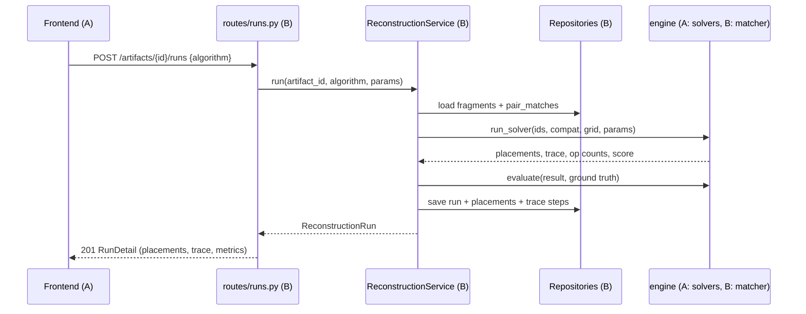
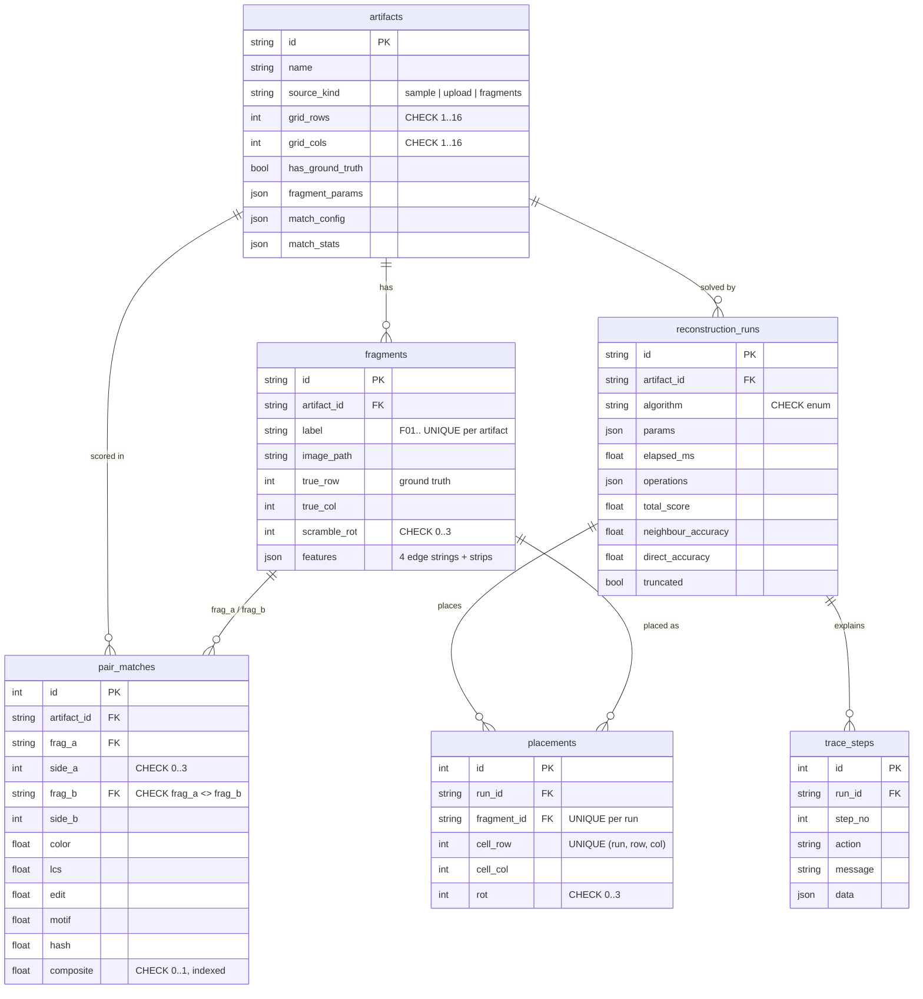

# RELIC-X — Architecture and File Ownership

This document describes how the system is built and **who owns which folder and file**.
Every file listed here either exists in the repository or is planned work tracked by a GitHub
issue (marked *planned*).

## Team key

| Member | Discipline | DSA slice |
|---|---|---|
| **A** — Arvind | Frontend | Graph & Search |
| **B** — Bhumi | Backend (incl. platform/DevOps) | Strings & Matching |

See [TEAM_ROLES.md](TEAM_ROLES.md) for each role's full responsibilities.

---

## 1. System architecture



### Layering rules

- The frontend talks only to `/api/v1`; it never touches the database or the file store.
- **Routes** (`api/routes/`) validate input with Pydantic and call exactly one service; no logic, no SQL.
- **Services** (`services/`) hold the business logic, call repositories and the engine, and raise
  *domain* errors (`core/errors.py`). They never return HTTP responses.
- **Repositories** (`repositories/`) are the only place that builds SQLAlchemy queries.
- **The engine** (`engine/`) imports nothing from the web, DB or service layers. This is enforced
  by `tests/engine/test_engine_purity.py`, so each algorithm is unit-testable and benchmarkable on its own.
- Integrity rules (sides 0–3, scores in [0, 1], no self-joins, one fragment per cell, valid
  algorithm names) are **database constraints**, not only Python checks.
- The two DSA slices meet at one interface: `compat[(frag_i, side_a, frag_j, side_b)] → score ∈ [0, 1]`.

### Request flow: running a solver



---

## 2. Database

Schema: `backend/src/relicx/db/models.py`; migrations: `backend/migrations/versions/`. Owner: **B**.



All child rows use `ON DELETE CASCADE`. Re-fragmenting an artifact deletes its matches and runs
in one transaction (`FragmentRepository.replace_all`).

---

## 3. Folder overview

```text
relic-x/
├── backend/        # B  - API, DB, platform  (engine/ is split A/B by slice)
├── frontend/       # A  - React app
├── validation/     # A (solver benchmarks), B (matcher experiments)
├── datasets/       # B  - sample artifacts and generator
├── docs/           # A + B - each documents their own work
├── planning/       # A + B - this file, roles, workflow, contract
├── .github/        # B  - CI, templates, CODEOWNERS
└── .devcontainer/  # B  - Codespaces
```

| Folder | Primary owner | Notes |
|---|---|---|
| `backend/src/relicx/{api,services,repositories,db,schemas,core}` | B | All API and persistence code |
| `backend/src/relicx/engine/strings/`, `features.py`, `fragmenter.py`, `matcher.py` | B | Strings & Matching slice |
| `backend/src/relicx/engine/graph.py`, `layout.py`, `metrics.py`, `solvers/` | A | Graph & Search slice |
| `backend/src/relicx/engine/{counters,pipeline,__init__}.py` | A + B | Shared interface; change only with both agreeing |
| `frontend/` | A | All UI code |
| `validation/` | A + B | File name shows the owner |
| `docs/` | A + B | Section headers show the owner |
| `.github/`, `.devcontainer/`, Docker files | B | Platform |

## 4. Where each person works

**A — Frontend + Graph & Search:** `frontend/**`, `engine/graph.py`, `engine/layout.py`,
`engine/metrics.py`, `engine/solvers/**`, `tests/engine/test_graph_solvers_metrics.py`,
`validation/run_benchmarks.py`, `docs/USER_GUIDE.md`, `docs/DEMO_SCRIPT.md`, Graph & Search sections of `docs/ALGORITHMS.md` and `docs/VIVA_NOTES.md`

**B — Backend + Strings & Matching:** `backend/**` except A's engine files, `engine/strings/**`,
`engine/features.py`, `engine/fragmenter.py`, `engine/matcher.py`, all backend tests except
A's, `.github/**`, `.devcontainer/**`, `docker-compose.yml`, `validation/matcher_experiments.py`,
`docs/API.md`, `docs/DATABASE.md`, `SECURITY.md`, `planning/CONTRACT.md`, Strings & Matching sections of `docs/ALGORITHMS.md` and `docs/VIVA_NOTES.md`

---

## 5. File-by-file ownership

### Root files

| File | Owner | Purpose |
|---|---|---|
| `README.md` | A + B | Project overview |
| `.gitignore`, `.env.example` | B | Ignore rules; environment template (no real secrets) |
| `docker-compose.yml` | B | postgres → migrate → api → web |
| `.devcontainer/devcontainer.json` | B | GitHub Codespaces environment |
| `.github/workflows/ci.yml` | B (backend jobs), A (frontend job) | CI |
| `.github/workflows/codeql.yml`, `dependabot.yml` | B | Security scanning, dependency updates |
| `.github/CODEOWNERS` | B | Automatic review requests: each area lists the OTHER member as reviewer |
| `CONTRIBUTING.md`, `CHANGELOG.md`, `LICENSE` | A + B | Project hygiene |
| `SECURITY.md` | B | Upload limits, secrets, reporting |

### backend — platform and API (B)

Layering: **routes** (HTTP + validation) → **services** (logic) → **repositories** (SQL) → **db** (models).

| File | Owner | Purpose |
|---|---|---|
| `backend/pyproject.toml` | B | Dependencies (`[api]`, `[dev]` extras), ruff, black, pytest config |
| `backend/Dockerfile`, `backend/.dockerignore` | B | API image |
| `backend/alembic.ini`, `migrations/env.py`, `migrations/versions/0001_initial_schema.py` | B | Migrations |
| `src/relicx/main.py` | B | App factory: CORS, request-ID middleware, error handlers, routers |
| `src/relicx/core/config.py` | B | Environment settings with safe dev defaults |
| `src/relicx/core/errors.py` | B | Domain errors → HTTP status mapping |
| `src/relicx/core/logging.py` | B | Logging setup |
| `src/relicx/db/base.py`, `session.py`, `models.py` | B | Declarative base, engine/session, ORM models + constraints |
| `src/relicx/repositories/__init__.py` | B | Artifact, Fragment, Match, Run repositories |
| `src/relicx/services/storage.py` | B | Local file storage, upload validation |
| `src/relicx/services/artifacts.py` | B | Create from sample/upload/fragments; fragmenting |
| `src/relicx/services/matching.py` | B | Matching, graph payload, "Why matched?" explanation |
| `src/relicx/services/reconstruction.py` | B | Runs, benchmarks, scaling experiment |
| `src/relicx/schemas/__init__.py` | B | Pydantic request/response models (the contract) |
| `src/relicx/api/deps.py`, `presenters.py` | B | Dependency injection; ORM → response mapping |
| `src/relicx/api/routes/{health,artifacts,matching,runs}.py` | B | Endpoints |
| `src/relicx/samples.py` | B | Procedural sample artifacts |
| *planned* `src/relicx/services/jobs.py` | B | Background run jobs (T20) |
| *planned* `src/relicx/api/routes/exports.py` | B | CSV exports (T21) |
| *planned* `src/relicx/cli.py` | B | `relicx seed` demo data (T05) |

### backend — algorithm engine (split by slice)

| File | Owner | Purpose |
|---|---|---|
| `engine/strings/kmp.py` | B | KMP prefix function and search |
| `engine/strings/rabin_karp.py` | B | Rolling hash and search |
| `engine/strings/motif.py` | B | Longest shared motif (binary search + KMP/RK) |
| `engine/strings/lcs.py` | B | LCS length (two-row DP) and alignment |
| `engine/strings/edit_distance.py` | B | Levenshtein distance and operation script |
| `engine/strings/hashing.py` | B | n-gram signatures, Jaccard, memo cache |
| `engine/features.py` | B | Edge strips → symbol strings |
| `engine/fragmenter.py` | B | Synthetic fragmentation with ground truth |
| `engine/matcher.py` | B | Pre-filter + composite scoring, `compat_table` |
| `engine/graph.py` | A | Weighted graph, pruning, BFS/DFS components |
| `engine/layout.py` | A | Grid geometry, placement scoring |
| `engine/solvers/greedy.py` | A | Greedy frontier placement |
| `engine/solvers/best_first.py` | A | Prim-style best-first growth |
| `engine/solvers/dijkstra.py` | A | Dijkstra shortest-path tree placement |
| `engine/solvers/backtracking.py` | A | Backtracking with branch & bound |
| `engine/solvers/common.py` | A | `SolverResult`, `TraceRecorder` |
| `engine/metrics.py` | A | Neighbour / direct / match accuracy |
| *planned* `engine/solvers/strip_dp.py` | A | DP extension for 2 × n strips (T17) |
| `engine/counters.py`, `engine/pipeline.py` | A + B | Op counters; end-to-end pipeline |

### backend — tests

| File | Owner | Purpose |
|---|---|---|
| `tests/engine/test_strings.py` | B | KMP/RK vs naive, LCS/edit textbook cases, DP consistency |
| `tests/engine/test_features_and_matching.py` | B | Rotation permutes sides, fragmenter truth, matcher accuracy |
| `tests/engine/test_engine_purity.py` | B | Engine must not import web/DB |
| `tests/engine/test_graph_solvers_metrics.py` | A | Graph, every solver on clean 3×3, B&B ≥ greedy, metrics |
| `tests/api/test_api.py` | B | Full pipeline via HTTP, error contract, uploads |
| `tests/test_migrations.py` | B | Upgrade/downgrade + no drift from models |

### frontend (A)

| File | Owner | Purpose |
|---|---|---|
| `frontend/package.json`, `vite.config.ts`, `tsconfig.json`, `index.html` | A | Tooling (scaffolded) |
| `frontend/Dockerfile`, `nginx.conf` | A | Production image (static build + nginx) |
| `src/main.tsx`, `src/App.tsx` | A | Entry and app shell (scaffolded) |
| `src/api/client.ts` | A | Typed fetch wrapper, error shape (scaffolded) |
| `src/api/schema.d.ts` | A | Generated from OpenAPI by `npm run gen:types`; do not edit |
| *planned* `src/api/mocks/*` | A | Mock payloads from CONTRACT §6 (T03) |
| *planned* `src/routes.tsx`, `src/components/layout/*` | A | Routing, navbar, layout (T03) |
| *planned* `src/pages/ProjectsPage.tsx`, `components/ArtifactWizard.tsx` | A | T23 |
| *planned* `src/pages/GalleryPage.tsx`, `components/EdgeBeads.tsx` | A | T24 |
| *planned* `src/pages/GraphPage.tsx` | A | T25 |
| *planned* `src/components/WhyMatchedDrawer.tsx` | A | T26 |
| *planned* `src/pages/ReconstructionPage.tsx`, `components/TracePlayer.tsx` | A | T27 |
| *planned* `src/pages/LabPage.tsx`, `components/charts/*` | A | T28 |

### validation, datasets, docs

| File | Owner | Purpose |
|---|---|---|
| `validation/run_benchmarks.py` | A | Solver accuracy/time/ops vs n → `results.md` |
| *planned* `validation/matcher_experiments.py` | B | KMP vs RK, weight sweep, robustness (T31) |
| `validation/results.md` | A + B | Generated tables |
| `datasets/README.md`, `datasets/generate_samples.py` | B | Sample artifacts |
| `docs/ALGORITHMS.md`, `docs/VIVA_NOTES.md` | A + B | Each fills their own slice's sections |
| `docs/API.md`, `docs/DATABASE.md` | B | T41, T42 |
| `docs/USER_GUIDE.md`, `docs/DEMO_SCRIPT.md` | A | T44 |

---

## 6. Scope and design decisions

| Decision | Choice | Why |
|---|---|---|
| Fragment shape | Square grid tiles, 90° rotations | Keeps the ADA focus; contours and 3-D are future work (synopsis §7) |
| Edge representation | Clockwise strip → resampled → quantised symbol string | Makes string algorithms (KMP, LCS, edit) meaningful on images |
| Two-stage matching | Hash + colour pre-filter, then O(L²) DP on survivors | Turns O(P·L²) into O(P·L + P′·L²) with P′ ≪ P |
| Solver interface | `compat` table only | The two DSA slices evolve independently |
| Backtracking | Branch & bound seeded with greedy, node limit | Guaranteed ≥ greedy, bounded time, honest `truncated` flag |
| Dev database | SQLite by default; PostgreSQL in compose/CI | Zero setup for development; production-grade for the demo |
| Auth | None in v0.1 (single-user lab); optional API key in T22 | Matches the synopsis; easy to extend |
| Long runs | Synchronous in v0.1; background jobs in T20 | Simple first, scalable next |
