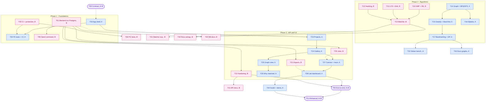

# RELIC-X — Team Workflow

How the two of us work together: what can start immediately, what has to wait for something
else, and where the hand-offs happen. **Every task below is a GitHub issue** with the same ID
in its title (for example `T25 · Similarity graph view`), assigned to its owner.

Member key (see [TEAM_ROLES.md](TEAM_ROLES.md)):

| Member | Discipline | DSA slice |
|---|---|---|
| **A** — Arvind | Frontend | Graph & Search |
| **B** — Bhumi | Backend (incl. platform/DevOps) | Strings & Matching |

Ownership of each file is in [ARCHITECTURE.md](ARCHITECTURE.md).

---

## 1. How the project is sequenced

Work moves through **gates**. A gate is a checkpoint that must pass before the tasks after it
count as unblocked for integration. Many tasks can still be *started* early from the contract
and the mock API (section 6). Each gate is a **GitHub milestone**.

| Gate | Meaning | Passes when |
|---|---|---|
| **G0** Contract agreed | Both build against the same shapes | [CONTRACT.md](CONTRACT.md) reviewed and signed off by A and B |
| **G1** Foundations ready | Backend runs everywhere, frontend shell exists | Backend on PostgreSQL via compose, CI green with branch protection, app shell + mock client merged |
| **G2** Algorithms verified | Every algorithm is owned and measured | T10 – T17 closed: tests, complexity write-up and experiment for every algorithm |
| **G3** Feature complete | Every screen works on the real API | T20 – T28 closed |
| **G4** Demo ready | Ready to present | Validation, docs, end-to-end run and rehearsal closed |

---

## 2. Task list with dependencies

**Reading the table:** a task can start when everything in *Needs* is done. "Draft" means you
can start from the contract or mocks before the prerequisite is finished, and finalise after.

### Phase 0 — Contract (milestone G0)

| ID | Task | Owner | Needs |
|---|---|---|---|
| T00 | Contract review and sign-off ([CONTRACT.md](CONTRACT.md)) | A + B | — |

### Phase 1 — Foundations (milestone G1)

| ID | Task | Owner | Needs |
|---|---|---|---|
| T01 | Backend on PostgreSQL via docker-compose; Alembic upgrade; dev setup verified on Windows/macOS/Codespaces | B | — |
| T02 | CI green on every push; branch protection on `main` (1 approval + CI) | B | — |
| T03 | Frontend app shell: routing, layout, theme, API client with mock mode, generated types | A | T00 (draft before) |
| T04 | Frontend tests (Vitest + RTL) and frontend CI job | A | T03; T02 for the CI job |
| T05 | Demo seed command: three sample artifacts with matches and runs | B | T01 |

### Phase 2 — Algorithms (milestone G2)

Every task delivers the DSA quota in [TEAM_ROLES.md §1](TEAM_ROLES.md#1-dsa-work-divided-equally):
tests → complexity derivation → measured experiment → viva notes.

| ID | Task | Owner | Needs |
|---|---|---|---|
| T10 | KMP + Rabin-Karp + longest-motif binary search | B | — |
| T11 | LCS + Edit Distance (DP) | B | — |
| T12 | Hashing pre-filter (n-gram signatures, Jaccard) + memo cache | B | — |
| T13 | Feature extraction + composite matcher (weights, robustness) | B | T10 – T12 |
| T14 | Fragment graph, pruning, BFS / DFS | A | — |
| T15 | Greedy + Best-first (Prim) | A | T14 |
| T16 | Dijkstra (shortest-path tree assembly) | A | T14 |
| T17 | Backtracking + branch & bound + DP extension | A | T15 |

### Phase 3 — API and UI (milestone G3)

| ID | Task | Owner | Needs |
|---|---|---|---|
| T20 | Background jobs for long runs (create → poll) | B | T01; status shape agreed with A |
| T21 | CSV export endpoints (run, benchmark, scaling) | B | T01 |
| T22 | API hardening: pagination headers, optional API key, rate limit | B | T01 |
| T23 | Projects page + create-artifact wizard | A | T03; real API after T01 |
| T24 | Fragment gallery + edge bead strips | A | T23 |
| T25 | Similarity graph view (threshold, top-k, BFS/DFS) | A | T24 |
| T26 | "Why matched?" drawer | A | T25 |
| T27 | Reconstruction canvas + trace playback + ground-truth overlay | A | T24; progress bar after T20 |
| T28 | Lab / benchmark dashboard + scaling chart + CSV export | A | T27; download after T21 |

### Phase 4 — Testing and validation (milestone G4)

| ID | Task | Owner | Needs |
|---|---|---|---|
| T30 | PostgreSQL integration tests in CI + coverage ≥ 85 % | B | T02 |
| T31 | Matcher experiments (KMP vs RK, weight sweep, noise/erosion) | B | T13 |
| T32 | Solver benchmarks (accuracy, time, ops vs n) + results tables | A | T17 |

### Phase 5 — Documentation (milestone G4, drafted continuously)

| ID | Task | Owner | Needs |
|---|---|---|---|
| T40 | Strings & Matching sections of ALGORITHMS.md + VIVA_NOTES.md | B | T10 – T13 |
| T41 | `docs/API.md` + final CONTRACT.md | B | T20 – T22 |
| T42 | `docs/DATABASE.md`: ER diagram, constraints, migration guide | B | T01 |
| T43 | Graph & Search sections of ALGORITHMS.md + VIVA_NOTES.md | A | T14 – T17 |
| T44 | User guide with screenshots, demo script, slides | A | T23 – T28 |

### Phase 6 — Integration and demo (milestone G4)

| ID | Task | Owner | Needs |
|---|---|---|---|
| T50 | End-to-end run on a fresh clone + bug bash | A + B | G3 |
| T51 | Demo rehearsal (each presents their segment) | A + B | T44, T50 |

---

## 3. Dependency diagram

Arrows mean "must finish before". Dashed arrows mean "can draft early, finalise after".

---

## 4. What can run in parallel

Right after T00, **both members are fully unblocked**:

| A — Arvind can do now | B — Bhumi can do now |
|---|---|
| T03 app shell with mock data | T01 backend on PostgreSQL |
| T14 – T17 algorithm tests and write-ups | T02 CI + branch protection |
| Static versions of every page from CONTRACT §6 payloads | T10 – T13 algorithm tests and write-ups |

Nothing in Phase 2 depends on the other person: the two DSA slices meet only through the
`compat` table (CONTRACT §3), which is already fixed.

## 5. Critical path

`T00 → T03 → T23 → T24 → T27 → T28 → T50 → T51`

The frontend pages are the longest chain, so B should take on any shared work (CI fixes,
fixtures, mock data) whenever A is blocked.

## 6. Working without being blocked

- **Mock mode (A):** the API client reads `VITE_USE_MOCKS=true` and serves the example payloads
  from CONTRACT §6, so every page can be built before the backend is deployed anywhere.
- **Swagger (B):** `http://localhost:8000/docs` is the live contract; A can try any endpoint there.
- **Algorithm work is independent:** both slices already run, so tests and analysis can start on day one.

## 7. How we work day to day

1. Pick the next unblocked issue assigned to you (Projects board column *Ready*).
2. Branch: `a/t25-graph-view` or `b/t20-async-jobs`.
3. Open a draft PR early; link the issue (`Closes #N`).
4. CI green → mark ready → the other member reviews → author merges.
5. If you change the API, update CONTRACT.md in the same PR.

## 8. Progress tracker

Progress lives on GitHub: **Issues** (filter `assignee:@me`) and **Milestones** G0 – G4.
Labels: `owner:A-arvind`, `owner:B-bhumi`, `area:*`, `phase:*`, `dsa`.
