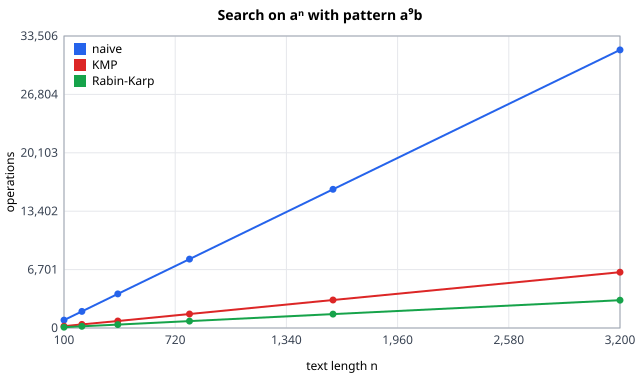
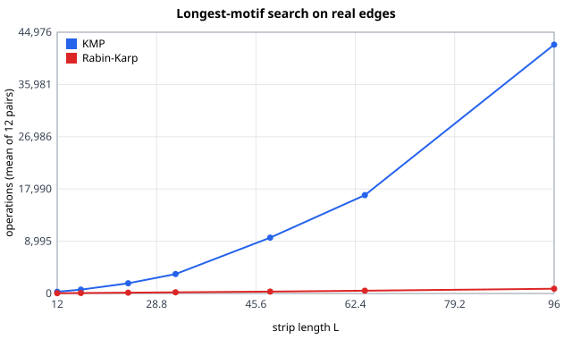
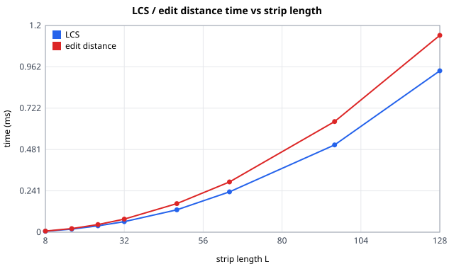
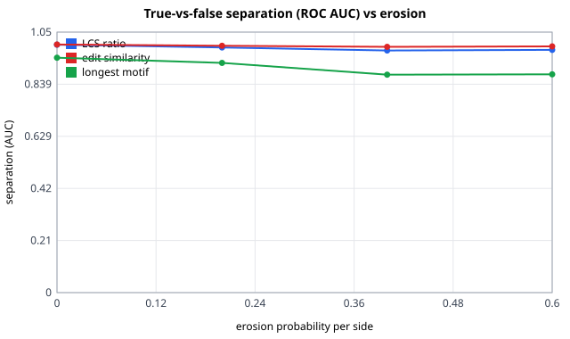
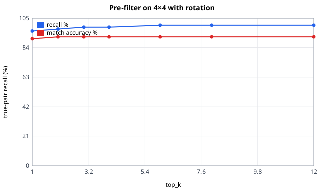
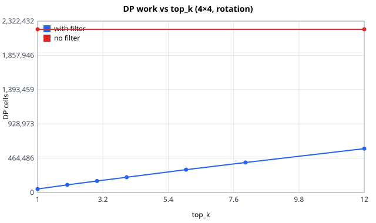
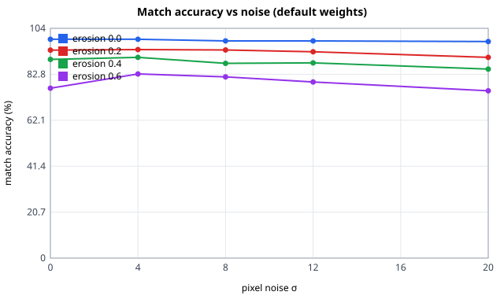

# RELIC-X — Strings & Matching results

Generated by `validation/matcher_experiments.py` (owner: B). Fixed seeds: counts and accuracies are identical on
every run; wall-clock times (ms, speed-ups) vary by a few percent.
Solver results are in [results.md](results.md).

<!-- t10 -->
## T10 · KMP, Rabin-Karp and the longest-motif search

**Adversarial input** `text = aⁿ`, `pattern = a⁹b` (10 chars, never matches). Naive re-checks 10
characters at every shift; KMP never moves backwards in the text.

| n | naive comparisons | KMP comparisons (incl. table) | KMP bound 2n−1 + 2m−3 | Rabin-Karp ops (hashes + verifications) |
|---|---|---|---|---|
| 100 | 910 | 208 | 216 | 91 |
| 200 | 1,910 | 408 | 416 | 191 |
| 400 | 3,910 | 808 | 816 | 391 |
| 800 | 7,910 | 1,608 | 1,616 | 791 |
| 1600 | 15,910 | 3,208 | 3,216 | 1,591 |
| 3200 | 31,910 | 6,408 | 6,416 | 3,191 |

- KMP: grows as n^0.99 (R² 1.0000); never above the bound.
- naive: grows as n^1.02 (R² 0.9999) too, but it does ≈ m·n = 10n comparisons against KMP's ≈ 2n: 5.0× more here, and the gap grows linearly with the pattern length m.
- Rabin-Karp: grows as n^1.02 (R² 0.9999): one hash per window, no collisions with MOD = 10⁹+7.

**Longest shared motif on real edges.** 12 truly adjacent E/W edge pairs of the pottery sample (4×4,
noise 4, erosion 0.2), strip length L varied. Both methods return the same motif every time.

| L | KMP ops (mean) | Rabin-Karp ops (mean) | ratio | motif length / L |
|---|---|---|---|---|
| 12 | 297 | 54 | 5.5× | 0.48 |
| 16 | 667 | 76 | 8.8× | 0.45 |
| 24 | 1,750 | 139 | 12.6× | 0.40 |
| 32 | 3,342 | 201 | 16.6× | 0.39 |
| 48 | 9,610 | 328 | 29.3× | 0.34 |
| 64 | 16,934 | 480 | 35.3× | 0.38 |
| 96 | 42,834 | 823 | 52.1× | 0.36 |

- KMP decision step: grows as L^2.38 (R² 0.9988): up to L windows, each an O(L) KMP scan, per binary-search step → O(L² log L).
- Rabin-Karp decision step: grows as L^1.31 (R² 0.9993): one hash set per step → O(L log L) expected.
- KMP stays the default (`motif_method="kmp"`) for its deterministic worst case; at L = 24 the motif step is a small part of matching either way. Rabin-Karp is the better choice for long strips (switch with `MatchParams.motif_method`).

<!-- /t10 -->

<!-- t11 -->
## T11 · LCS and edit distance (dynamic programming)

**Cost vs strip length L** (random strings, both length L; best of 5 runs).

| L | DP cells | LCS ms | edit ms |
|---|---|---|---|
| 8 | 64 | 0.007 | 0.009 |
| 16 | 256 | 0.021 | 0.030 |
| 24 | 576 | 0.044 | 0.066 |
| 32 | 1,024 | 0.075 | 0.119 |
| 48 | 2,304 | 0.166 | 0.266 |
| 64 | 4,096 | 0.284 | 0.461 |
| 96 | 9,216 | 0.640 | 1.041 |
| 128 | 16,384 | 0.933 | 1.130 |

- DP cells are exactly L² every time (the counter ticks one per cell); LCS time: grows as L^1.83 (R² 0.9989), edit time: grows as L^1.83 (R² 0.9937).
- Memory is two rows of L + 1 integers, O(L), for the scores; only the "Why matched?" alignment builds the full (L + 1)² table, for one pair at a time.

**Do the scores separate true neighbours from wrong pairs?** All three samples, 4×4, noise σ = 4,
erosion varied. Every truly adjacent E–W / S–N edge pair vs every other opposite-side pair
(3 samples × 24 = 72 true and 3 × 456 = 1 368 false pairs per erosion level). *Separation* = probability that a random true pair scores
higher than a random false pair (ROC AUC: 0.5 = useless, 1.0 = perfect).

| erosion | LCS ratio true / false (mean) | edit sim. true / false (mean) | LCS separation | edit separation | motif separation |
|---|---|---|---|---|---|
| 0.0 | 0.81 / 0.21 | 0.78 / 0.10 | 0.998 | 0.999 | 0.946 |
| 0.2 | 0.70 / 0.21 | 0.66 / 0.10 | 0.987 | 0.994 | 0.925 |
| 0.4 | 0.62 / 0.22 | 0.57 / 0.10 | 0.975 | 0.990 | 0.878 |
| 0.6 | 0.63 / 0.22 | 0.58 / 0.10 | 0.977 | 0.991 | 0.879 |

- LCS and edit similarity both separate true from false pairs far better than chance, and degrade gracefully as erosion chips more of each edge: gaps cost LCS a little, a substitution costs edit distance 1, neither collapses.
- The contiguous motif is the most fragile signal: a single chipped segment breaks a run, which is why it is combined with the gap-tolerant DP scores instead of used alone (T13).

<!-- /t11 -->

<!-- t12 -->
## T12 · Hashing pre-filter (n-gram signatures + colour) and memo cache

Stage 1 scores **every** allowed side pair cheaply (n-gram Jaccard + colour continuity, O(L)); each side
keeps its `top_k` best partners; stage 2 runs LCS, edit distance and the motif search (O(L²)) only on the
union of those lists. Mean over the three samples, noise σ = 4, erosion 0.2. *Recall* = share of truly
adjacent fragment pairs that survive the filter; *match acc.* = share of true neighbours ranked first.

**5×5**

| top_k | pairs scored | DP cells | recall | match acc. | matching ms |
|---|---|---|---|---|---|
| 1 | 62 / 1,200 (5%) | 69,504 | 95% | 92% | 33 |
| 2 | 134 / 1,200 (11%) | 149,760 | 97% | 91% | 56 |
| 3 | 198 / 1,200 (16%) | 221,568 | 98% | 91% | 76 |
| 4 | 264 / 1,200 (22%) | 296,832 | 99% | 91% | 99 |
| 6 | 386 / 1,200 (32%) | 433,920 | 100% | 90% | 165 |
| 8 | 505 / 1,200 (42%) | 566,016 | 100% | 90% | 184 |
| 12 | 737 / 1,200 (61%) | 822,912 | 100% | 90% | 262 |
| all (no filter) | 1,200 / 1,200 (100%) | 1,335,552 | 100% | 90% | 436 |

- Default `top_k = 6` scores 32% of the pairs, does 32% of the DP work and runs 2.6× faster than no filter, with recall 100% and match accuracy 90% (no filter: 90%).

**4×4 with rotation (16 side combinations per pair)**

| top_k | pairs scored | DP cells | recall | match acc. | matching ms |
|---|---|---|---|---|---|
| 1 | 41 / 1,920 (2%) | 47,616 | 96% | 90% | 33 |
| 2 | 90 / 1,920 (5%) | 103,296 | 97% | 92% | 58 |
| 3 | 135 / 1,920 (7%) | 155,520 | 99% | 92% | 70 |
| 4 | 180 / 1,920 (9%) | 206,976 | 99% | 92% | 80 |
| 6 | 269 / 1,920 (14%) | 309,504 | 100% | 92% | 109 |
| 8 | 353 / 1,920 (18%) | 406,656 | 100% | 92% | 134 |
| 12 | 516 / 1,920 (27%) | 594,048 | 100% | 92% | 202 |
| all (no filter) | 1,920 / 1,920 (100%) | 2,211,840 | 100% | 92% | 751 |

- Default `top_k = 6` scores 14% of the pairs, does 14% of the DP work and runs 6.9× faster than no filter, with recall 100% and match accuracy 92% (no filter: 92%).

**Memo cache.** String scores are keyed by the (edge, reversed edge) pair, so identical pairs are computed
once. No filter, so every pair is a candidate.

| artifact | pairs scored | cache hits | hit rate |
|---|---|---|---|
| flat colour (worst case for duplicates) | 480 | 479 | 100% |
| mosaic-tile 5×5, clean | 1200 | 0 | 0% |
| pottery-band 5×5, clean | 1200 | 151 | 13% |
| manuscript 5×5, clean | 1200 | 0 | 0% |

- The cache fires exactly where edges repeat: every pair of a flat artifact, about one pair in eight on the pottery sample (its plain clay bands give identical edge strings), never on the busy mosaic and manuscript. It costs one dict lookup per pair, so plain regions cannot blow up matching time.

<!-- /t12 -->

<!-- t13 -->
## T13 · Edge features and the composite matcher

**Setup.** 9 artifacts per seed (3 samples × {4×4, 5×5, 4×4 rotated}), noise σ = 4, erosion 0.3. Component
scores are computed once per artifact (the pre-filter does not depend on the weights), then re-weighted.
*Match accuracy* = share of true neighbours ranked first by their side. Weights are **tuned on seed 7** and
**checked on seeds 21 and 42** (18 unseen artifacts) to avoid overfitting.

**Ablation** (held-out seeds 21 + 42).

| scores used | match accuracy |
|---|---|
| default weights {'color': 0.4, 'lcs': 0.2, 'edit': 0.15, 'motif': 0.15, 'hash': 0.1} | **91.8%** |
| color only | 88.3% |
| lcs only | 84.7% |
| edit only | 88.1% |
| motif only | 54.9% |
| hash only | 69.9% |
| default without color | 84.2% |
| default without lcs | 92.3% |
| default without edit | 91.9% |
| default without motif | 92.7% |
| default without hash | 91.8% |

**Grid search.** Every weight in {0, 1, 2, 3, 4} (relative; 3,124 combinations), ranked on seed 7 (1 s).

| weights (color, lcs, edit, motif, hash) | tuning acc. (seed 7) | held-out acc. (21 + 42) |
|---|---|---|
| default (0.4, 0.2, 0.15, 0.15, 0.1) | 95.7% | 91.8% |
| best-ranked (4, 2, 2, 0, 3) | 96.0% | 92.3% |
| best-ranked (4, 2, 2, 0, 2) | 96.0% | 92.3% |
| best-ranked (4, 1, 4, 0, 3) | 96.0% | 92.9% |
| best-ranked (4, 1, 3, 1, 3) | 96.0% | 91.8% |
| best-ranked (4, 1, 3, 0, 3) | 96.0% | 92.2% |

- Held-out set: 528 ranking decisions, so one decision is 0.2%. The best tuned weights gain +0.5% (2 decisions); the top-10 grid points average 92.1% vs 91.8% for the default. All within 1 point: a plateau, so **the defaults are kept**. Moving them would fit noise.
- **Colour carries most of the signal** (alone 88.3%; removing it costs 7.6%). The string scores add +3.5% on top of colour: each is weaker alone, but they fail on different pairs than colour does.
- **The motif does not help ranking on these artifacts** (alone 54.9%; the best weights set it to 0, and removing it changes accuracy by less than 1 point). It stays in the score at a small weight because it is the most *explainable* evidence in the "Why matched?" panel ("these 10 symbols continue across the break"); its weight can be set to 0 per request via `MatchParams.weights`.

**Robustness of the default weights** (3 samples × 3 layouts, seed 21).

| noise σ \ erosion | 0.0 | 0.2 | 0.4 | 0.6 |
|---|---|---|---|---|
| 0 | 99% | 94% | 90% | 77% |
| 4 | 99% | 94% | 90% | 83% |
| 8 | 98% | 94% | 88% | 82% |
| 12 | 98% | 93% | 88% | 79% |
| 20 | 98% | 90% | 85% | 75% |

- Erosion hurts more than pixel noise: σ = 20 costs 1–8 points, 60 % erosion costs 16–23, because a chipped segment replaces a whole run of symbols while noise only flips a few bins. Small non-monotone steps (e.g. σ 0 → 4 at erosion 0.6) come from the 9-artifact sample size.

**Feature resolution** (seed 21, noise σ = 4, erosion 0.3; time = feature extraction + matching).

| levels | strip_len | match accuracy | ms per artifact |
|---|---|---|---|
| 3 | 16 | 91.9% | 73 |
| 3 | 24 | 90.6% | 120 |
| 3 | 32 | 92.9% | 177 |
| 4 | 16 | 90.8% | 74 |
| 4 | 24 (default) | 92.1% | 112 |
| 4 | 32 | 91.6% | 180 |

- All six settings are within about 2 points; cost grows with L² as expected. `levels = 4, strip_len = 24` stays the default: middle cost, and 64 symbols keep the strings readable in the UI.

<!-- /t13 -->

