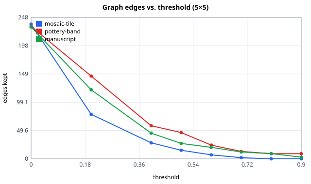
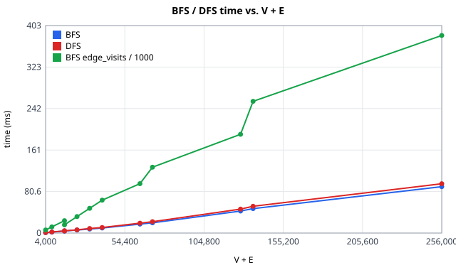
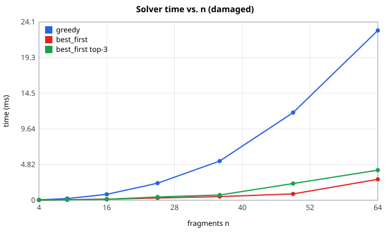
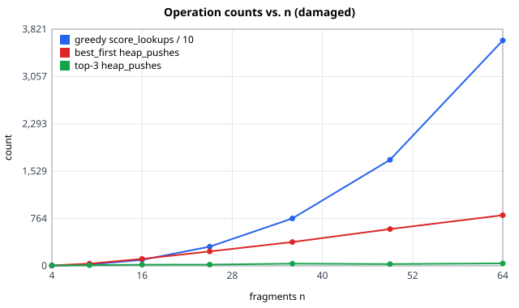
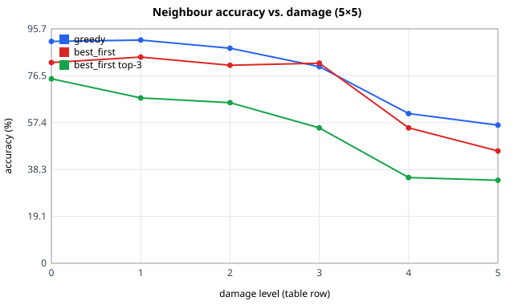
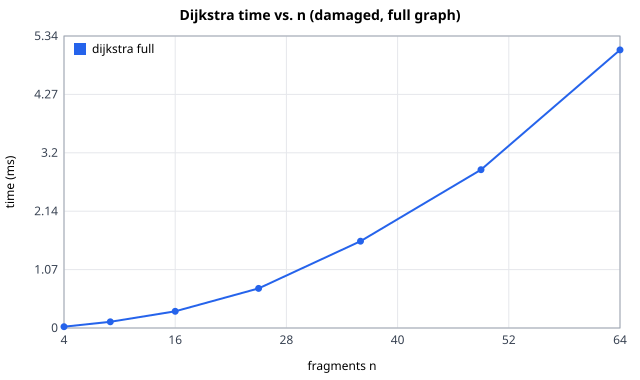
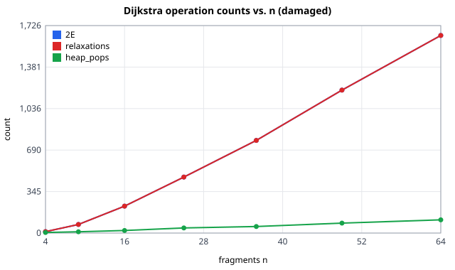
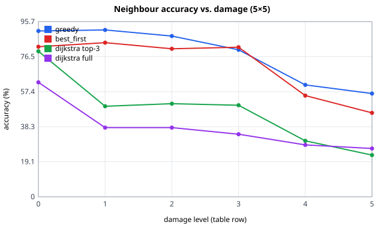

# RELIC-X — validation results

Generated by `validation/run_benchmarks.py` (node limit 50,000). Each cell is the mean over
the three bundled samples (mosaic-tile, pottery-band, manuscript). **acc.** = neighbour accuracy (share of true
adjacent pairs reconstructed correctly); **ms** = solver time only (matching excluded);
**\*** = backtracking hit its node limit on at least one sample and returned its best-so-far.

### clean

| n | match acc. | greedy acc. / ms | best_first acc. / ms | dijkstra acc. / ms | backtracking acc. / ms |
|---|---|---|---|---|---|
| 9 | 92% | 89% / 0.4 | 89% / 0.1 | 89% / 0.1 | 100% / 2.2 |
| 16 | 100% | 100% / 1.0 | 100% / 0.2 | 100% / 0.1 | 100% / 7.3 |
| 25 | 96% | 87% / 2.9 | 81% / 0.4 | 74% / 0.5 | 87% / 169.3* |
| 36 | 96% | 87% / 6.4 | 87% / 0.6 | 82% / 0.8 | 93% / 213.4* |

### damaged

| n | match acc. | greedy acc. / ms | best_first acc. / ms | dijkstra acc. / ms | backtracking acc. / ms |
|---|---|---|---|---|---|
| 9 | 83% | 83% / 0.4 | 81% / 0.1 | 83% / 0.1 | 100% / 5.7 |
| 16 | 99% | 100% / 1.0 | 100% / 0.2 | 75% / 0.2 | 100% / 27.1 |
| 25 | 90% | 89% / 3.0 | 72% / 0.4 | 55% / 0.6 | 89% / 205.5* |
| 36 | 81% | 91% / 7.5 | 66% / 0.9 | 45% / 1.6 | 91% / 220.8* |

### damaged + rotation

| n | match acc. | greedy acc. / ms | best_first acc. / ms | dijkstra acc. / ms | backtracking acc. / ms |
|---|---|---|---|---|---|
| 9 | 78% | 78% / 0.7 | 78% / 0.1 | 78% / 0.1 | 89% / 166.0* |
| 16 | 99% | 100% / 3.5 | 100% / 0.2 | 71% / 0.3 | 100% / 203.7* |
| 25 | 79% | 72% / 8.2 | 73% / 0.4 | 48% / 0.9 | 72% / 207.8* |
| 36 | 69% | 79% / 22.2 | 70% / 1.6 | 33% / 2.7 | 79% / 229.8* |

## Reading the tables

- Greedy scores each candidate against *all* placed neighbours, which makes it hard to beat on these inputs.
- Backtracking starts from the greedy solution and can only improve the total compatibility score.
  Higher score does not always mean higher accuracy when the matcher itself is wrong.
- Best-first (Prim) is the fastest; it trusts single strongest joins.
- Dijkstra minimises *path* cost from the seed, which is the wrong objective for assembly;
  it is kept as the comparison point (see docs/ALGORITHMS.md).

Owners: solver experiments **A**, matcher experiments **B** (T31, separate section to be added).

<!-- T14:begin (generated by run_benchmarks.py) -->

## Fragment graph (T14, `engine/graph.py`)

Regenerate with `python validation/run_benchmarks.py --graph-only`. Counts, edge numbers and accuracies are deterministic; times are wall-clock and vary by machine.

### Edges vs. threshold and top-k (5×5 grid, damaged: noise 4, erosion 0.3, seed 7)

25 fragments, **40** true adjacent pairs. Each cell: **edges (share that are true neighbours) / components / largest component**. Edges are the best side pairing per fragment pair after pruning.

Threshold sweep (no top-k):

| threshold | mosaic-tile | pottery-band | manuscript |
|---|---|---|---|
| 0.0 | 236 (16%) / 1 / 25 | 232 (17%) / 1 / 25 | 231 (17%) / 1 / 25 |
| 0.2 | 78 (47%) / 1 / 25 | 145 (27%) / 1 / 25 | 121 (31%) / 1 / 25 |
| 0.4 | 28 (86%) / 4 / 22 | 58 (60%) / 1 / 25 | 45 (58%) / 1 / 25 |
| 0.5 | 15 (93%) / 11 / 7 | 46 (54%) / 2 / 24 | 27 (81%) / 3 / 23 |
| 0.6 | 7 (100%) / 18 / 4 | 24 (58%) / 9 / 15 | 20 (90%) / 7 / 19 |
| 0.7 | 2 (100%) / 23 / 2 | 13 (46%) / 16 / 7 | 12 (100%) / 14 / 6 |
| 0.8 | 0 (–) / 25 / 1 | 9 (33%) / 20 / 6 | 9 (100%) / 16 / 5 |
| 0.9 | 0 (–) / 25 / 1 | 9 (33%) / 20 / 6 | 3 (100%) / 22 / 3 |

Mutual top-k sweep (threshold 0):

| top-k | mosaic-tile | pottery-band | manuscript |
|---|---|---|---|
| 1 (≤ 12 edges) | 8 (100%) / 17 / 2 | 4 (50%) / 21 / 2 | 5 (100%) / 20 / 2 |
| 2 (≤ 25 edges) | 17 (100%) / 8 / 7 | 14 (79%) / 11 / 5 | 15 (80%) / 10 / 6 |
| 3 (≤ 37 edges) | 30 (97%) / 1 / 25 | 28 (75%) / 2 / 24 | 24 (88%) / 4 / 22 |
| 4 (≤ 50 edges) | 38 (87%) / 1 / 25 | 38 (61%) / 1 / 25 | 35 (77%) / 2 / 24 |
| 6 (≤ 75 edges) | 60 (60%) / 1 / 25 | 57 (54%) / 1 / 25 | 57 (56%) / 1 / 25 |
| none (no pruning) | 236 (16%) / 1 / 25 | 232 (17%) / 1 / 25 | 231 (17%) / 1 / 25 |

### BFS / DFS scaling (seeded random graphs)

Random graphs with V nodes and average degree d (E = V·d/2); first the V sweep at d = 6, then the d sweep at V = 8,000. `edge_visits` is the engine's own operation counter; time is the best of 5 runs of the traversal alone (graph already built), neighbours sorted by weight as in production.

| V | E | V + E | BFS edge_visits | BFS ms | DFS edge_visits | DFS ms |
|---|---|---|---|---|---|---|
| 1,000 | 3,000 | 4,000 | 6,000 | 0.85 | 6,000 | 1.00 |
| 2,000 | 6,000 | 8,000 | 12,000 | 1.83 | 12,000 | 2.02 |
| 4,000 | 12,000 | 16,000 | 24,000 | 3.82 | 24,000 | 4.11 |
| 8,000 | 8,000 | 16,000 | 16,000 | 4.06 | 16,000 | 4.26 |
| 8,000 | 16,000 | 24,000 | 32,000 | 5.89 | 32,000 | 6.28 |
| 8,000 | 24,000 | 32,000 | 48,000 | 7.70 | 48,000 | 8.77 |
| 8,000 | 32,000 | 40,000 | 64,000 | 9.75 | 64,000 | 10.76 |
| 16,000 | 48,000 | 64,000 | 96,000 | 17.46 | 96,000 | 19.23 |
| 8,000 | 64,000 | 72,000 | 128,000 | 19.86 | 128,000 | 22.13 |
| 32,000 | 96,000 | 128,000 | 192,000 | 42.79 | 192,000 | 46.48 |
| 8,000 | 128,000 | 136,000 | 256,000 | 47.50 | 256,000 | 52.01 |
| 64,000 | 192,000 | 256,000 | 384,000 | 90.17 | 384,000 | 95.78 |

Least-squares fits over all rows (x = V + E):

| quantity | slope | intercept | R² |
|---|---|---|---|
| BFS edge_visits | 1.569 per (V+E) | 739.62 | 0.9831 |
| DFS edge_visits | 1.569 per (V+E) | 739.62 | 0.9831 |
| BFS time | 359.149 ms per 10⁶ (V+E) | -2.85 | 0.9955 |
| DFS time | 383.671 ms per 10⁶ (V+E) | -2.71 | 0.9962 |

Exactly 2E adjacency entries are scanned: BFS edge_visits vs E has slope 2.000, R² 1.0000.

### Extra space: BFS queue vs. DFS stack (peak entries)

Measured with instrumented copies of the engine traversals (the DFS copy is asserted to produce the engine's exact visit order). A node can be pushed on the DFS stack once per incident edge before it is popped, so the stack is bounded by O(E), while the BFS queue holds each node at most once, O(V).

| graph | V | E | BFS queue peak | DFS stack peak | DFS peak / E |
|---|---|---|---|---|---|
| complete K8 | 8 | 28 | 7 | 22 | 0.79 |
| complete K16 | 16 | 120 | 15 | 106 | 0.88 |
| complete K32 | 32 | 496 | 31 | 466 | 0.94 |
| complete K64 | 64 | 2,016 | 63 | 1,954 | 0.97 |
| random d=6, V=1,000 | 1,000 | 3,000 | 536 | 2,090 | 0.70 |
| random d=6, V=64,000 | 64,000 | 192,000 | 34,156 | 133,402 | 0.69 |
<!-- T14:end -->

<!-- T15:begin (generated by run_benchmarks.py) -->

## Greedy and best-first (T15, `solvers/greedy.py`, `solvers/best_first.py`)

Regenerate with `python validation/run_benchmarks.py --greedy-bf-only`. Accuracies and operation counts are deterministic (fixed seeds); `ms` is the solver alone, single run, mean over instances, and varies by machine. No rotation. Each cell is the mean over the 3 samples × seeds [1, 2, 3]. `best_first` uses the full graph (threshold 0, no top-k), which is what the API does by default; `best_first top-3` prunes the graph with mutual top-3 first.

### clean: accuracy, time, operations vs. n

| n | greedy nbr / direct acc. | greedy ms | greedy score_lookups | best_first nbr / direct acc. | best_first ms | heap_pushes | heap_pops | top-3 nbr acc. | top-3 ms | top-3 pushes |
|---|---|---|---|---|---|---|---|---|---|---|
| 4 | 100% / 100% | 0.06 | 22 | 100% / 100% | 0.02 | 6 | 6 | 100% | 0.02 | 6 |
| 9 | 89% / 89% | 0.25 | 216 | 89% / 89% | 0.08 | 36 | 36 | 89% | 0.06 | 12 |
| 16 | 100% / 100% | 0.78 | 914 | 100% / 100% | 0.14 | 113 | 113 | 100% | 0.10 | 21 |
| 25 | 91% / 86% | 2.26 | 3,072 | 82% / 79% | 0.32 | 234 | 234 | 75% | 0.35 | 23 |
| 36 | 87% / 85% | 5.12 | 7,263 | 87% / 85% | 0.49 | 373 | 373 | 83% | 0.58 | 38 |
| 49 | 97% / 95% | 11.68 | 17,532 | 89% / 88% | 0.81 | 579 | 579 | 85% | 1.10 | 53 |
| 64 | 81% / 76% | 21.22 | 33,097 | 73% / 63% | 1.43 | 796 | 796 | 67% | 2.55 | 55 |

### damaged (noise 4, erosion 0.3): accuracy, time, operations vs. n

| n | greedy nbr / direct acc. | greedy ms | greedy score_lookups | best_first nbr / direct acc. | best_first ms | heap_pushes | heap_pops | top-3 nbr acc. | top-3 ms | top-3 pushes |
|---|---|---|---|---|---|---|---|---|---|---|
| 4 | 100% / 100% | 0.05 | 22 | 100% / 100% | 0.02 | 6 | 6 | 100% | 0.02 | 6 |
| 9 | 86% / 86% | 0.23 | 205 | 93% / 93% | 0.07 | 36 | 36 | 88% | 0.07 | 10 |
| 16 | 91% / 92% | 0.80 | 968 | 91% / 92% | 0.15 | 112 | 112 | 90% | 0.12 | 19 |
| 25 | 91% / 85% | 2.31 | 3,108 | 84% / 80% | 0.30 | 233 | 233 | 68% | 0.45 | 20 |
| 36 | 89% / 83% | 5.30 | 7,660 | 85% / 80% | 0.49 | 385 | 385 | 76% | 0.71 | 35 |
| 49 | 85% / 82% | 11.85 | 17,125 | 82% / 77% | 0.86 | 594 | 594 | 54% | 2.26 | 28 |
| 64 | 75% / 70% | 22.96 | 36,395 | 57% / 47% | 2.84 | 818 | 818 | 46% | 4.07 | 40 |

### Best-first on the unpruned graph: pushes vs. edges, conflicts and fallbacks (damaged (noise 4, erosion 0.3))

Each undirected edge is pushed at most once (by whichever endpoint is committed first), so pushes ≤ E. The few missing pushes belong to fragments placed by fallback, which push nothing.

| n | E (graph edges) | heap_pushes | conflicts | fallbacks |
|---|---|---|---|---|
| 9 | 36 | 36 | 1.9 | 0.1 |
| 16 | 112 | 112 | 4.3 | 0.1 |
| 25 | 233 | 233 | 18.6 | 0.3 |
| 36 | 386 | 385 | 31.8 | 0.6 |
| 49 | 595 | 594 | 80.6 | 1.2 |
| 64 | 822 | 818 | 197.7 | 3.2 |

### Fitted growth: log y vs. log n, damaged (noise 4, erosion 0.3), n = 9…64 fragments

Slope of the least-squares line through log(mean y) against log(n); an O(n^p) algorithm gives p (`n log n` appears as a slope slightly above 1).

| quantity | slope p | R² |
|---|---|---|
| greedy score_lookups | 2.62 | 0.9998 |
| greedy time | 2.35 | 0.9991 |
| best_first heap_pushes | 1.58 | 0.9917 |
| best_first heap_pops | 1.58 | 0.9917 |
| best_first time | 1.73 | 0.9487 |
| best_first top-3 heap_pushes | 0.66 | 0.8989 |
| best_first top-3 time | 2.16 | 0.9727 |

### Greedy vs. best-first as noise and erosion rise (5×5 = 25 fragments)

Neighbour accuracy, mean over samples × seeds; the last column is the largest gap on a single instance in best-first's favour (0 or below = greedy was never behind).

| noise | erosion | greedy | best_first | best_first top-3 | worst case: best_first − greedy |
|---|---|---|---|---|---|
| 0 | 0 | 90.6% | 81.9% | 75.3% | +0.0% |
| 4 | 0.3 | 91.1% | 84.2% | 67.5% | +10.0% |
| 8 | 0.3 | 87.8% | 80.8% | 65.6% | +0.0% |
| 16 | 0.3 | 80.3% | 81.7% | 55.3% | +27.5% |
| 16 | 0.6 | 61.1% | 55.3% | 35.0% | +15.0% |
| 32 | 0.6 | 56.4% | 45.8% | 33.9% | +5.0% |

Chart x-axis: row index of this table (0 = clean … 5 = noise 32, erosion 0.6).

### Optimality on tiny grids (exhaustive search, no rotation)

Random symmetric compat tables (random weights on random side pairs); the optimum is the best of all assignments of fragments to cells.

| grid | tables | greedy reaches optimum | best_first reaches optimum | greedy mean score / optimum | best_first mean score / optimum |
|---|---|---|---|---|---|
| 2×2 | 300 | 48% | 33% | 0.892 | 0.796 |
| 2×3 | 300 | 25% | 10% | 0.873 | 0.748 |

**Counterexample where greedy fails** (the instance written out in docs/ALGORITHMS.md §10; fragments A–D, 2×2):

| solver | total score | layout (row-major) |
|---|---|---|
| greedy | 1.05 | C D / B A |
| best_first | 1.05 | C D / B A |
| optimum (exhaustive) | 1.40 | D A / C B |

<!-- T15:end -->

<!-- T16:begin (generated by run_benchmarks.py) -->

## Dijkstra (T16, `solvers/dijkstra.py`)

Regenerate with `python validation/run_benchmarks.py --dijkstra-only`. Accuracies and counts are deterministic (fixed seeds); `ms` is the solver alone, single run, and varies by machine. No rotation. Each cell is the mean over the 3 samples × seeds [1, 2, 3]. `dijkstra top-3` is how the API runs it (mutual top-3 graph); `dijkstra full` uses the unpruned graph, like `best_first`.

### clean: accuracy, time, operations vs. n (Dijkstra, full graph)

| n | E | heap_pops | relaxations (2E?) | score_lookups | conflicts | unreachable | nbr / direct acc. | ms |
|---|---|---|---|---|---|---|---|---|
| 4 | 6 | 5 | 12 | 1 | 0.3 | 0.0 | 100% / 100% | 0.02 |
| 9 | 36 | 15 | 72 | 4 | 1.0 | 0.0 | 89% / 89% | 0.08 |
| 16 | 113 | 32 | 225 | 25 | 4.0 | 0.0 | 90% / 94% | 0.21 |
| 25 | 234 | 50 | 468 | 104 | 11.1 | 0.0 | 62% / 64% | 0.57 |
| 36 | 373 | 78 | 747 | 260 | 20.3 | 0.0 | 46% / 45% | 1.33 |
| 49 | 580 | 117 | 1,159 | 396 | 24.3 | 0.0 | 51% / 51% | 2.31 |
| 64 | 797 | 157 | 1,594 | 731 | 37.1 | 0.0 | 38% / 28% | 4.35 |

### damaged (noise 4, erosion 0.3): accuracy, time, operations vs. n (Dijkstra, full graph)

| n | E | heap_pops | relaxations (2E?) | score_lookups | conflicts | unreachable | nbr / direct acc. | ms |
|---|---|---|---|---|---|---|---|---|
| 4 | 6 | 5 | 12 | 1 | 0.3 | 0.0 | 100% / 100% | 0.02 |
| 9 | 36 | 11 | 72 | 18 | 3.8 | 0.0 | 73% / 79% | 0.11 |
| 16 | 112 | 21 | 224 | 63 | 8.1 | 0.0 | 69% / 76% | 0.30 |
| 25 | 233 | 42 | 466 | 173 | 16.3 | 0.0 | 38% / 38% | 0.72 |
| 36 | 386 | 54 | 771 | 389 | 27.4 | 0.0 | 32% / 29% | 1.59 |
| 49 | 595 | 83 | 1,190 | 624 | 37.7 | 0.0 | 29% / 25% | 2.89 |
| 64 | 822 | 110 | 1,644 | 963 | 49.1 | 0.0 | 25% / 19% | 5.08 |

### Fitted growth, damaged (noise 4, erosion 0.3), n = 9…64 fragments (Dijkstra, full graph)

Slope of log(mean y) against log(n) with R². Relaxations are compared with 2E: the ratio is relaxations / (2E), where E is the number of edges of the graph Dijkstra ran on.

| quantity | slope p | R² |
|---|---|---|
| heap_pops | 1.18 | 0.9944 |
| relaxations | 1.58 | 0.9919 |
| score_lookups (fallbacks) | 2.06 | 0.9952 |
| time | 1.95 | 0.9984 |
| E (graph edges) | 1.58 | 0.9919 |

relaxations / 2E = 1.00…1.00; heap_pops / E = 0.13…0.30 (pops = V settles + stale entries, bounded by 1 + the number of improving relaxations ≤ 1 + 2E).

### Dijkstra vs. best-first vs. greedy as noise and erosion rise (5×5 = 25 fragments)

Neighbour accuracy, mean over samples × seeds; conflicts are Dijkstra's per run (a child whose parent cell was taken); the last two columns compare the **tree**: mean join weight of Dijkstra's shortest-path tree against the maximum spanning tree (Prim's target), and the share of fragments whose Dijkstra parent differs from the maximum-spanning-tree parent.

| noise | erosion | greedy | best_first | dijkstra top-3 | dijkstra full | conflicts (full) | mean tree edge: Dijkstra / max spanning tree | parent differs |
|---|---|---|---|---|---|---|---|---|
| 0 | 0 | 90.6% | 81.9% | 79.4% | 62.5% | 11.1 | 0.703 / 0.820 | 40% |
| 4 | 0.3 | 91.1% | 84.2% | 49.4% | 37.8% | 16.3 | 0.517 / 0.685 | 62% |
| 8 | 0.3 | 87.8% | 80.8% | 50.8% | 37.8% | 16.1 | 0.482 / 0.656 | 61% |
| 16 | 0.3 | 80.3% | 81.7% | 50.0% | 34.2% | 17.8 | 0.393 / 0.594 | 77% |
| 16 | 0.6 | 61.1% | 55.3% | 30.6% | 28.3% | 20.2 | 0.318 / 0.512 | 79% |
| 32 | 0.6 | 56.4% | 45.8% | 22.8% | 26.4% | 21.1 | 0.285 / 0.442 | 79% |

Chart x-axis: row index of this table (0 = clean … 5 = noise 32, erosion 0.6).

### Accuracy vs. n, side by side (damaged)

| n | greedy | best_first | dijkstra top-3 | dijkstra full |
|---|---|---|---|---|
| 4 | 100% | 100% | 100% | 100% |
| 9 | 86% | 93% | 86% | 73% |
| 16 | 91% | 91% | 73% | 69% |
| 25 | 91% | 84% | 49% | 38% |
| 36 | 89% | 85% | 59% | 32% |
| 49 | 85% | 82% | 39% | 29% |
| 64 | 75% | 57% | 36% | 25% |

**Counterexample (docs/ALGORITHMS.md §12; fragments A, B, C in a 2×2 grid, seed A):**

Dijkstra settles A (dist 0.00), C (dist 0.65), B (dist 0.75); B's parent is A (Prim's: C).

| solver | total score | layout (row-major) |
|---|---|---|
| dijkstra | 0.60 | . C / B A |
| best_first | 0.95 | C B / A . |
| optimum (exhaustive) | 0.95 | |

<!-- T16:end -->
