# RELIC-X — validation results

Generated by `validation/run_benchmarks.py`. Owners: solver experiments **A**, matcher experiments **B**
([`matcher_results.md`](matcher_results.md)).

<!-- T32:begin (generated by run_benchmarks.py) -->

<!-- T32:meta {"commit": "b546606", "date": "2026-11-15", "erosions": [0.0, 0.1, 0.2, 0.3, 0.4], "machine": "arm64, 10 logical CPUs", "node_limit": 50000, "noises": [0.0, 2.0, 4.0, 8.0, 12.0], "numpy": "2.5.4", "os": "macOS-26.6.2-arm64-arm-64bit-Mach-O", "python": "3.14.7", "repeats": 3, "samples": ["mosaic-tile", "pottery-band", "manuscript"], "seconds": 219, "seeds": [1, 2, 3, 4], "sizes": [2, 3, 4, 5, 6, 7, 8], "sweep_size": 5} -->

## Solver evaluation (T32): accuracy, time and operations vs. n

Regenerate with `python validation/run_benchmarks.py --solvers-only` (about 3 min 39 s here; `--quick` is a smaller set; `--check` verifies the committed numbers). Per-run rows: [`solver_runs.csv`](solver_runs.csv); aggregate: [`solver_summary.csv`](solver_summary.csv).

### Summary

- **What was run.** Grids 2×2 … 8×8 (n = 4 … 64 fragments), scenarios `clean`, `damaged`, `damaged + rotation` (damage = noise 4, erosion 0.3) plus noise and erosion sweeps at 5×5; samples mosaic-tile, pottery-band, manuscript; seeds 1, 2, 3, 4; so every cell is **N = 12 runs** (3 samples × 4 seeds). Backtracking always ran with a **node limit of 50,000**. Times are the best of 3 solver runs, matching excluded.
- **Provenance.** commit `b546606`, 2026-11-15, Python 3.14.7, numpy 2.5.4, macOS-26.6.2-arm64-arm-64bit-Mach-O, arm64, 10 logical CPUs; the full run took 219 s. Counts, scores and accuracies are deterministic (fixed seeds); only the time columns vary between runs and machines.
- **Finding 1.** Accuracy, `damaged`, n = 64: greedy 74 ± 20%, backtracking 74 ± 20%, best-first 58 ± 11%, Dijkstra 37 ± 11%. The spread does **not** support a single winner: the top intervals overlap, so no ranking is claimed. *(table: `damaged` neighbour accuracy; chart: accuracy vs. n)*
- **Finding 2.** Cost, `damaged`, n = 64: greedy 22.16 ms and 35,743 operations, best-first 1.52 ms and 1,651, Dijkstra 3.78 ms and 864; greedy does 21.6× the operations of best-first. *(tables: operations, time; charts: time and operations vs. n)*
- **Finding 3.** Backtracking is measurable only for small n: it first hits the node limit (50,000) at n = 16 (`damaged`) and at n = 64 12 of 12 runs are truncated, so its time there (206 ms) is the cost of the limit, not of solving. *(table: truncated vs. complete runs)*
- **Finding 4.** Matcher vs. solver, `damaged`, n = 64: the matcher's top choice is right for 83% of true adjacencies. With the ground-truth adjacency instead of the matcher, neighbour accuracy goes greedy 74% → 100%, best-first 58% → 100%, Dijkstra 37% → 100%, backtracking 74% → 100%. The gap to 100 % in the oracle figure is lost by the solver; the rise from real to oracle is lost by the matcher. *(table: oracle)*

How to read a cell: **mean ± standard deviation over the N runs** of that cell; a **bold** value is the only one whose 95 % interval (mean ± 1.96·sd/√N) lies above every other solver's, otherwise no ranking is claimed; `* (k/N truncated)` means backtracking hit its node limit on k of the N runs and returned its best-so-far. *Neighbour accuracy* is the share of truly adjacent pairs that are adjacent on the correct sides in the layout; *direct accuracy* is the share of fragments in exactly the right cell (best global shift and rotation); *coverage* is the share of fragments placed at all. These are the same three numbers the API and the Lab page show.

### clean

**Neighbour accuracy** (mean ± sd), with the matcher's own accuracy:

| n | match acc. | greedy | best-first | Dijkstra | backtracking |
|---|---|---|---|---|---|
| 4 | 100 ± 0% | 100 ± 0% | 100 ± 0% | 100 ± 0% | 100 ± 0% |
| 9 | 92 ± 12% | 89 ± 16% | 89 ± 16% | 89 ± 16% | **100 ± 0%** |
| 16 | 100 ± 0% | 100 ± 0% | 100 ± 0% | 100 ± 0% | 100 ± 0% |
| 25 | 96 ± 6% | 88 ± 22% | 82 ± 27% | 78 ± 33% | 91 ± 17% * (4/12 truncated) |
| 36 | 96 ± 5% | 87 ± 20% | 87 ± 20% | 82 ± 27% | 87 ± 19% * (12/12 truncated) |
| 49 | 96 ± 4% | 97 ± 5% | 89 ± 8% | 66 ± 3% | 97 ± 5% * (12/12 truncated) |
| 64 | 98 ± 1% | 81 ± 19% | 72 ± 20% | 69 ± 30% | 82 ± 17% * (12/12 truncated) |

**Direct accuracy / coverage / total score** (means):

| n | greedy | best-first | Dijkstra | backtracking |
|---|---|---|---|---|
| 4 | 100% / 100% / 2.8 | 100% / 100% / 2.8 | 100% / 100% / 2.8 | 100% / 100% / 2.8 |
| 9 | 89% / 100% / 7.4 | 89% / 100% / 7.4 | 89% / 100% / 7.4 | 100% / 100% / 7.6 |
| 16 | 100% / 100% / 17.5 | 100% / 100% / 17.5 | 100% / 100% / 17.5 | 100% / 100% / 17.5 |
| 25 | 84% / 100% / 27.5 | 79% / 100% / 26.2 | 75% / 100% / 24.5 | 86% / 100% / 28.0 |
| 36 | 85% / 100% / 37.6 | 85% / 100% / 37.7 | 80% / 100% / 35.6 | 85% / 100% / 37.7 |
| 49 | 95% / 100% / 61.4 | 88% / 100% / 57.6 | 63% / 100% / 46.5 | 95% / 100% / 61.4 |
| 64 | 76% / 100% / 74.3 | 63% / 100% / 68.9 | 65% / 100% / 67.2 | 76% / 100% / 74.7 |

**Operations** (deterministic; mean total of the solver's own counters):

| n | greedy | best-first | Dijkstra | backtracking |
|---|---|---|---|---|
| 4 | 22 | 12 | 18 | 28 |
| 9 | 216 | 72 | 35 | 1,037 |
| 16 | 914 | 226 | 61 | 5,545 |
| 25 | 3,087 | 469 | 153 | 127,522* |
| 36 | 7,263 | 749 | 201 | 150,542* |
| 49 | 17,532 | 1,162 | 359 | 150,498* |
| 64 | 33,097 | 1,611 | 531 | 152,270* |

**Time, ms** (machine-dependent; best of k, mean ± sd over the N runs; `*` = truncated runs included):

| n | greedy | best-first | Dijkstra | backtracking |
|---|---|---|---|---|
| 4 | 0.04 ± 0.01 | 0.02 ± 0.00 | 0.02 ± 0.00 | 0.04 ± 0.00 |
| 9 | 0.21 ± 0.00 | 0.07 ± 0.01 | 0.06 ± 0.01 | 1.08 ± 0.83 |
| 16 | 0.74 ± 0.01 | 0.13 ± 0.00 | 0.10 ± 0.00 | 5.96 ± 1.42 |
| 25 | 2.21 ± 0.08 | 0.28 ± 0.07 | 0.35 ± 0.28 | 144.31 ± 31.74* |
| 36 | 5.06 ± 0.15 | 0.46 ± 0.13 | 0.59 ± 0.39 | 184.84 ± 12.58* |
| 49 | 11.52 ± 0.54 | 0.77 ± 0.14 | 1.49 ± 0.29 | 212.83 ± 1.35* |
| 64 | 20.95 ± 1.06 | 1.36 ± 0.44 | 2.17 ± 1.47 | 219.17 ± 23.06* |

**Oracle (ground-truth adjacency instead of the matcher): neighbour accuracy, real matcher → oracle** (means):

| n | match acc. | greedy | best-first | Dijkstra | backtracking |
|---|---|---|---|---|---|
| 4 | 100% | 100% → 100% | 100% → 100% | 100% → 100% | 100% → 100% |
| 9 | 92% | 89% → 100% | 89% → 100% | 89% → 100% | 100% → 100% |
| 16 | 100% | 100% → 100% | 100% → 100% | 100% → 100% | 100% → 100% |
| 25 | 96% | 88% → 100% | 82% → 100% | 78% → 100% | 91% → 100% |
| 36 | 96% | 87% → 100% | 87% → 100% | 82% → 100% | 87% → 100% |
| 49 | 96% | 97% → 100% | 89% → 100% | 66% → 100% | 97% → 100% |
| 64 | 98% | 81% → 100% | 72% → 100% | 69% → 100% | 82% → 100% |

### damaged

**Neighbour accuracy** (mean ± sd), with the matcher's own accuracy:

| n | match acc. | greedy | best-first | Dijkstra | backtracking |
|---|---|---|---|---|---|
| 4 | 100 ± 0% | 100 ± 0% | 100 ± 0% | 100 ± 0% | 100 ± 0% |
| 9 | 87 ± 10% | 87 ± 21% | 92 ± 15% | 85 ± 24% | 98 ± 7% |
| 16 | 95 ± 5% | 93 ± 15% | 93 ± 13% | 77 ± 26% | 95 ± 12% * (2/12 truncated) |
| 25 | 89 ± 5% | 90 ± 13% | 83 ± 19% | 53 ± 22% | 91 ± 13% * (12/12 truncated) |
| 36 | 85 ± 6% | 88 ± 20% | 83 ± 19% | 66 ± 30% | 88 ± 20% * (12/12 truncated) |
| 49 | 84 ± 5% | 85 ± 17% | 84 ± 14% | 44 ± 22% | 86 ± 17% * (12/12 truncated) |
| 64 | 83 ± 4% | 74 ± 20% | 58 ± 11% | 37 ± 11% | 74 ± 20% * (12/12 truncated) |

**Direct accuracy / coverage / total score** (means):

| n | greedy | best-first | Dijkstra | backtracking |
|---|---|---|---|---|
| 4 | 100% / 100% / 2.4 | 100% / 100% / 2.4 | 100% / 100% / 2.4 | 100% / 100% / 2.4 |
| 9 | 87% / 100% / 5.7 | 92% / 100% / 5.8 | 88% / 100% / 5.5 | 97% / 100% / 5.9 |
| 16 | 94% / 100% / 12.9 | 94% / 100% / 12.8 | 78% / 100% / 11.4 | 95% / 100% / 12.9 |
| 25 | 85% / 100% / 20.6 | 80% / 100% / 20.0 | 51% / 100% / 15.2 | 86% / 100% / 20.7 |
| 36 | 84% / 100% / 30.4 | 80% / 100% / 29.9 | 67% / 100% / 25.2 | 84% / 100% / 30.4 |
| 49 | 82% / 100% / 44.6 | 80% / 100% / 43.9 | 38% / 100% / 30.6 | 84% / 100% / 44.6 |
| 64 | 67% / 100% / 53.8 | 48% / 100% / 47.0 | 26% / 100% / 35.7 | 67% / 100% / 53.8 |

**Operations** (deterministic; mean total of the solver's own counters):

| n | greedy | best-first | Dijkstra | backtracking |
|---|---|---|---|---|
| 4 | 22 | 12 | 18 | 35 |
| 9 | 208 | 72 | 37 | 3,280 |
| 16 | 963 | 224 | 75 | 51,016* |
| 25 | 3,119 | 468 | 183 | 150,253* |
| 36 | 7,713 | 776 | 252 | 150,543* |
| 49 | 17,426 | 1,191 | 502 | 151,491* |
| 64 | 35,743 | 1,651 | 864 | 153,168* |

**Time, ms** (machine-dependent; best of k, mean ± sd over the N runs; `*` = truncated runs included):

| n | greedy | best-first | Dijkstra | backtracking |
|---|---|---|---|---|
| 4 | 0.04 ± 0.00 | 0.02 ± 0.00 | 0.02 ± 0.00 | 0.05 ± 0.01 |
| 9 | 0.20 ± 0.01 | 0.06 ± 0.01 | 0.07 ± 0.02 | 3.25 ± 2.95 |
| 16 | 0.77 ± 0.03 | 0.14 ± 0.01 | 0.16 ± 0.07 | 53.38 ± 53.36* |
| 25 | 2.25 ± 0.07 | 0.28 ± 0.05 | 0.50 ± 0.16 | 169.84 ± 4.29* |
| 36 | 5.21 ± 0.23 | 0.48 ± 0.10 | 0.79 ± 0.37 | 184.61 ± 8.50* |
| 49 | 11.36 ± 0.63 | 0.79 ± 0.21 | 1.96 ± 0.56 | 196.47 ± 16.77* |
| 64 | 22.16 ± 1.73 | 1.52 ± 0.32 | 3.78 ± 0.61 | 205.54 ± 17.44* |

**Oracle (ground-truth adjacency instead of the matcher): neighbour accuracy, real matcher → oracle** (means):

| n | match acc. | greedy | best-first | Dijkstra | backtracking |
|---|---|---|---|---|---|
| 4 | 100% | 100% → 100% | 100% → 100% | 100% → 100% | 100% → 100% |
| 9 | 87% | 87% → 100% | 92% → 100% | 85% → 100% | 98% → 100% |
| 16 | 95% | 93% → 100% | 93% → 100% | 77% → 100% | 95% → 100% |
| 25 | 89% | 90% → 100% | 83% → 100% | 53% → 100% | 91% → 100% |
| 36 | 85% | 88% → 100% | 83% → 100% | 66% → 100% | 88% → 100% |
| 49 | 84% | 85% → 100% | 84% → 100% | 44% → 100% | 86% → 100% |
| 64 | 83% | 74% → 100% | 58% → 100% | 37% → 100% | 74% → 100% |

### damaged + rotation

**Neighbour accuracy** (mean ± sd), with the matcher's own accuracy:

| n | match acc. | greedy | best-first | Dijkstra | backtracking |
|---|---|---|---|---|---|
| 4 | 96 ± 10% | 100 ± 0% | 100 ± 0% | 100 ± 0% | 100 ± 0% |
| 9 | 88 ± 10% | 87 ± 20% | 81 ± 24% | 76 ± 28% | 85 ± 23% * (12/12 truncated) |
| 16 | 92 ± 4% | 95 ± 18% | 92 ± 20% | 65 ± 23% | 95 ± 18% * (12/12 truncated) |
| 25 | 79 ± 7% | 77 ± 30% | 73 ± 23% | 53 ± 22% | 78 ± 28% * (12/12 truncated) |
| 36 | 77 ± 7% | 73 ± 21% | 60 ± 19% | 41 ± 22% | 73 ± 21% * (12/12 truncated) |
| 49 | 76 ± 7% | 65 ± 20% | 50 ± 14% | 31 ± 7% | 65 ± 20% * (12/12 truncated) |
| 64 | 73 ± 3% | 60 ± 18% | 47 ± 13% | 22 ± 8% | 60 ± 18% * (12/12 truncated) |

**Direct accuracy / coverage / total score** (means):

| n | greedy | best-first | Dijkstra | backtracking |
|---|---|---|---|---|
| 4 | 100% / 100% / 2.4 | 100% / 100% / 2.4 | 100% / 100% / 2.4 | 100% / 100% / 2.4 |
| 9 | 89% / 100% / 5.8 | 86% / 100% / 5.7 | 78% / 100% / 5.5 | 87% / 100% / 5.9 |
| 16 | 95% / 100% / 12.4 | 90% / 100% / 12.2 | 70% / 100% / 10.2 | 95% / 100% / 12.4 |
| 25 | 73% / 100% / 18.7 | 71% / 100% / 18.4 | 54% / 100% / 15.4 | 74% / 100% / 18.9 |
| 36 | 70% / 100% / 27.3 | 56% / 100% / 24.7 | 40% / 100% / 21.0 | 70% / 100% / 27.3 |
| 49 | 55% / 100% / 38.3 | 40% / 100% / 33.6 | 25% / 100% / 27.6 | 55% / 100% / 38.3 |
| 64 | 51% / 100% / 49.1 | 34% / 100% / 43.6 | 14% / 100% / 31.2 | 51% / 100% / 49.1 |

**Operations** (deterministic; mean total of the solver's own counters):

| n | greedy | best-first | Dijkstra | backtracking |
|---|---|---|---|---|
| 4 | 88 | 12 | 21 | 2,287 |
| 9 | 859 | 74 | 61 | 150,205* |
| 16 | 3,818 | 210 | 177 | 150,706* |
| 25 | 12,319 | 425 | 545 | 152,047* |
| 36 | 31,525 | 718 | 1,030 | 154,566* |
| 49 | 71,436 | 1,073 | 2,010 | 158,941* |
| 64 | 152,777 | 1,523 | 3,876 | 165,422* |

**Time, ms** (machine-dependent; best of k, mean ± sd over the N runs; `*` = truncated runs included):

| n | greedy | best-first | Dijkstra | backtracking |
|---|---|---|---|---|
| 4 | 0.08 ± 0.01 | 0.02 ± 0.00 | 0.03 ± 0.01 | 2.14 ± 1.22 |
| 9 | 0.55 ± 0.01 | 0.07 ± 0.02 | 0.09 ± 0.03 | 145.06 ± 2.74* |
| 16 | 2.19 ± 0.10 | 0.15 ± 0.03 | 0.24 ± 0.09 | 156.96 ± 5.85* |
| 25 | 6.65 ± 0.34 | 0.31 ± 0.07 | 0.71 ± 0.29 | 162.10 ± 5.44* |
| 36 | 16.72 ± 0.75 | 0.65 ± 0.13 | 1.43 ± 0.45 | 172.62 ± 7.49* |
| 49 | 36.55 ± 2.09 | 1.03 ± 0.17 | 2.98 ± 0.47 | 180.14 ± 8.28* |
| 64 | 75.31 ± 4.71 | 1.72 ± 0.28 | 5.93 ± 0.86 | 197.35 ± 6.13* |

**Oracle (ground-truth adjacency instead of the matcher): neighbour accuracy, real matcher → oracle** (means):

| n | match acc. | greedy | best-first | Dijkstra | backtracking |
|---|---|---|---|---|---|
| 4 | 96% | 100% → 100% | 100% → 100% | 100% → 100% | 100% → 100% |
| 9 | 88% | 87% → 100% | 81% → 100% | 76% → 100% | 85% → 100% |
| 16 | 92% | 95% → 100% | 92% → 100% | 65% → 100% | 95% → 100% |
| 25 | 79% | 77% → 100% | 73% → 100% | 53% → 100% | 78% → 100% |
| 36 | 77% | 73% → 100% | 60% → 100% | 41% → 100% | 73% → 100% |
| 49 | 76% | 65% → 100% | 50% → 100% | 31% → 100% | 65% → 100% |
| 64 | 73% | 60% → 100% | 47% → 100% | 22% → 100% | 60% → 100% |

### Backtracking: truncated vs. complete runs (`damaged`)

Backtracking time is mostly the node limit once a run is truncated, so the two kinds of run are reported apart (limit 50,000 nodes).

| n | runs | truncated | neighbour acc. complete runs | neighbour acc. truncated runs | median ms complete | median ms truncated |
|---|---|---|---|---|---|---|
| 4 | 12 | 0/12 | 100% | — | 0.04 | — |
| 9 | 12 | 0/12 | 98% | — | 1.53 | — |
| 16 | 12 | 2/12 | 100% | 71% | 25.66 | 156.09 |
| 25 | 12 | 12/12 | — | 91% | — | 171.16 |
| 36 | 12 | 12/12 | — | 88% | — | 188.34 |
| 49 | 12 | 12/12 | — | 86% | — | 199.31 |
| 64 | 12 | 12/12 | — | 74% | — | 202.13 |

### noise sweep (5×5 = 25 fragments, erosion 0.3, no rotation)

| noise | match acc. | greedy | best-first | Dijkstra | backtracking | oracle (best of the four) |
|---|---|---|---|---|---|---|
| 0 | 91 ± 6% | 85 ± 25% | 84 ± 23% | 63 ± 34% | 85 ± 25% * (11/12 truncated) | 100% |
| 2 | 89 ± 5% | 91 ± 12% | 82 ± 20% | 56 ± 25% | 91 ± 13% * (12/12 truncated) | 100% |
| 4 | 89 ± 5% | 90 ± 13% | 83 ± 19% | 53 ± 22% | 91 ± 13% * (12/12 truncated) | 100% |
| 8 | 87 ± 5% | 85 ± 24% | 80 ± 23% | 51 ± 24% | 89 ± 15% * (12/12 truncated) | 100% |
| 12 | 87 ± 5% | 85 ± 21% | 80 ± 24% | 48 ± 22% | 89 ± 14% * (12/12 truncated) | 100% |

### erosion sweep (5×5 = 25 fragments, noise 4, no rotation)

| erosion | match acc. | greedy | best-first | Dijkstra | backtracking | oracle (best of the four) |
|---|---|---|---|---|---|---|
| 0 | 96 ± 6% | 88 ± 19% | 85 ± 23% | 75 ± 39% | 90 ± 19% * (12/12 truncated) | 100% |
| 0.1 | 92 ± 7% | 86 ± 22% | 79 ± 27% | 70 ± 37% | 88 ± 21% * (12/12 truncated) | 100% |
| 0.2 | 92 ± 5% | 86 ± 21% | 84 ± 25% | 65 ± 30% | 91 ± 17% * (12/12 truncated) | 100% |
| 0.3 | 89 ± 5% | 90 ± 13% | 83 ± 19% | 53 ± 22% | 91 ± 13% * (12/12 truncated) | 100% |
| 0.4 | 86 ± 7% | 85 ± 19% | 76 ± 25% | 48 ± 27% | 85 ± 19% * (12/12 truncated) | 100% |

### Fitted growth, `damaged`, n = 4…64 (log y against log n)

Least-squares line through the cell means over the sizes where **no run was truncated** (`slope` is the exponent k in y ≈ c·n^k; the number of points is in brackets; `—` = fewer than 3 usable points). The fit is reported as measured, not adjusted toward the derivation.

| solver | operations: k (R²) | time: k (R²) | derived bound (docs/ALGORITHMS.md) |
|---|---|---|---|
| greedy | 2.65 (1.000) [7] | 2.30 (0.999) [7] | O(R·n³), about n^2.5 in practice |
| best-first | 1.77 (0.988) [7] | 1.52 (0.995) [7] | O(E log E), E ≈ n^1.6 |
| Dijkstra | 1.41 (0.980) [7] | 1.83 (0.982) [7] | O((V + E) log V) |
| backtracking | — | — | exponential (b^n) |

- **greedy**: operations grow as n^2.65 (R² 1.000); this agrees with the estimate of about n^2.5 and respects the bound n^3.
- **best-first**: operations grow as n^1.77 (R² 0.988); this agrees with the estimate of about n^1.6 and respects the bound n^2.6.
- **Dijkstra**: operations grow as n^1.41 (R² 0.980); this **differs** from the estimate of about n^1; likely reason: score_lookups (fallback placement of fragments the top-3 graph does not reach) are 79% of its operations at n = 64, which grow faster than the (V + E) log V core.
- **Backtracking**: complete only for n = 4…9, where its nodes go from 35 to 3,280 operations; beyond that the node limit caps the cost, so a power-law fit is not meaningful and exponential growth is shown by the node counts of the T17 section instead.

### Charts

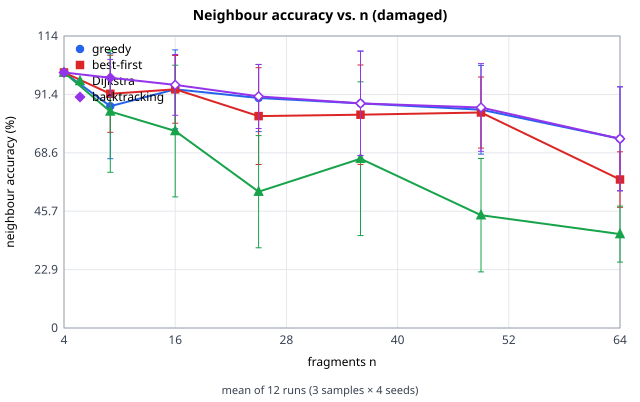

*Figure: Neighbour accuracy of each solver against n, `damaged` (noise 4, erosion 0.3). mean of 12 runs (3 samples × 4 seeds); error bars ±1 sd; hollow markers: backtracking truncated on at least one run.*

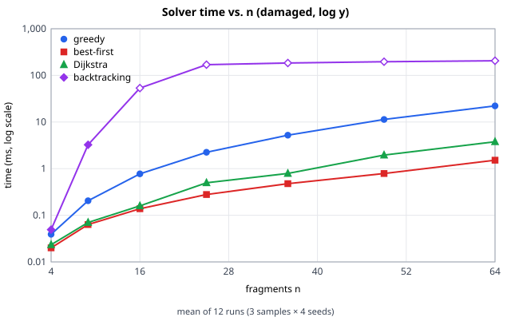

*Figure: Solver wall time (matching excluded; best of 3) against n, log y axis. mean of 12 runs (3 samples × 4 seeds); hollow markers: backtracking truncated, so its time is the node-limit cost.*

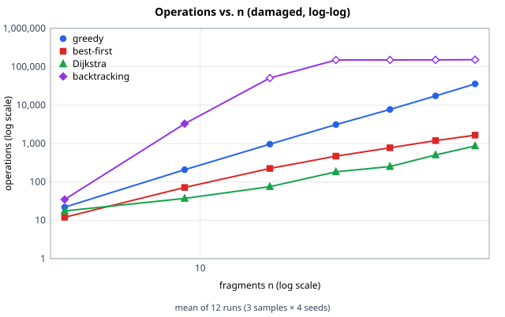

*Figure: Total operation counters of each solver against n on log-log axes; a straight line is a power law. mean of 12 runs (3 samples × 4 seeds); hollow: backtracking truncated.*

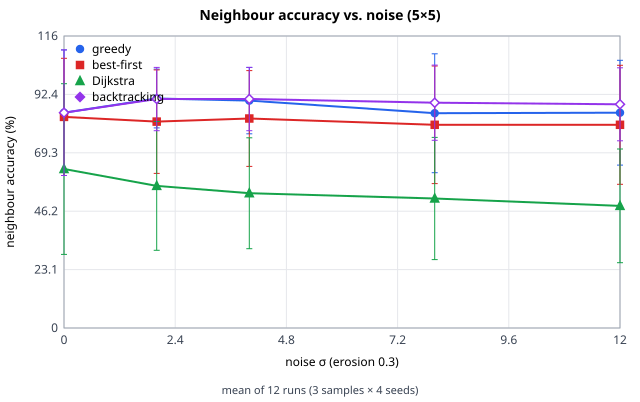

*Figure: Neighbour accuracy against noise at 5×5, erosion 0.3, no rotation. mean of 12 runs (3 samples × 4 seeds); error bars ±1 sd.*

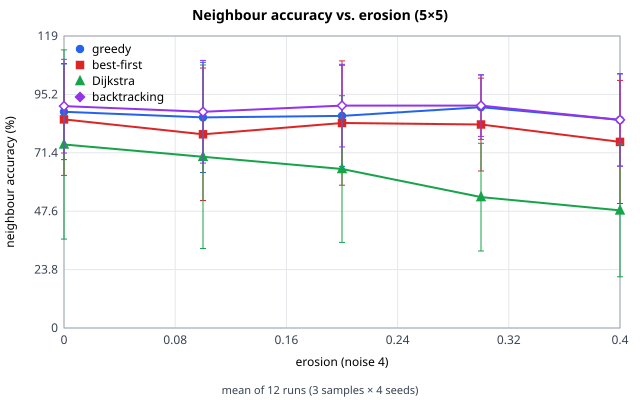

*Figure: Neighbour accuracy against erosion at 5×5, noise 4, no rotation. mean of 12 runs (3 samples × 4 seeds); error bars ±1 sd.*

### What we can and cannot conclude

- **Spread.** Every cell is a mean over N = 12 runs, not a population value; differences smaller than the 95 % interval are not rankings (only a bold cell is a ranking). The runs share samples and seeds across solvers, so the intervals are conservative for the *difference* between two solvers but not a significance test.
- **Truncation.** Backtracking always has a node limit (50,000). A truncated run returns its best-so-far, which is at least the greedy layout; its time measures the limit and its accuracy is a lower bound on what an unbounded search would find. Truncated and complete runs are reported apart.
- **Matcher.** A solver cannot beat the matcher on the pairs the matcher gets wrong. The oracle tables rerun every solver with the ground-truth adjacency; the gap between real and oracle accuracy is the matcher's share, the gap from 100 % in the oracle column is the solver's. The oracle uses perfect scores for true pairs and nothing for other pairs, so it is an upper bound, not a realistic matcher.
- **Data.** The bundled samples are *synthetic* fragmentations of three generated images, with known ground truth and a simple damage model (noise and edge erosion). They say how the algorithms behave on clean-ish tiling puzzles, not how they would behave on real archaeological material.
- **Time.** Timings depend on the machine, Python version and load; compare them within one run only. Operation counts, scores and accuracies are deterministic.

### More detail

- Fragment graph (T14): [Fragment graph](#fragment-graph-t14-enginegraphpy)
- Greedy and best-first (T15): [Greedy and best-first](#greedy-and-best-first-t15-solversgreedypy-solversbest_firstpy)
- Dijkstra (T16): [Dijkstra](#dijkstra-t16-solversdijkstrapy)
- Backtracking and the row DP (T17): [Backtracking + branch and bound](#backtracking--branch-and-bound-and-the-row-dp-t17-solversbacktrackingpy-solversrow_dppy)
- Matcher experiments (owned by B): [`matcher_results.md`](matcher_results.md)

<!-- T32:end -->
<!-- T14:begin (generated by run_benchmarks.py) -->

## Fragment graph (T14, `engine/graph.py`)

Regenerate with `python validation/run_benchmarks.py --graph-only`. Counts, edge numbers and accuracies are deterministic; times are wall-clock and vary by machine.

### Edges vs. threshold and top-k (5×5 grid, damaged: noise 4, erosion 0.3, seed 7)

25 fragments, **40** true adjacent pairs. Each cell: **edges (share that are true neighbours) / components / largest component**. Edges are the best side pairing per fragment pair after pruning.

Threshold sweep (no top-k):

| threshold | mosaic-tile | pottery-band | manuscript |
|---|---|---|---|
| 0.0 | 236 (16%) / 1 / 25 | 232 (17%) / 1 / 25 | 231 (17%) / 1 / 25 |
| 0.2 | 78 (47%) / 1 / 25 | 145 (27%) / 1 / 25 | 121 (31%) / 1 / 25 |
| 0.4 | 28 (86%) / 4 / 22 | 58 (60%) / 1 / 25 | 45 (58%) / 1 / 25 |
| 0.5 | 15 (93%) / 11 / 7 | 46 (54%) / 2 / 24 | 27 (81%) / 3 / 23 |
| 0.6 | 7 (100%) / 18 / 4 | 24 (58%) / 9 / 15 | 20 (90%) / 7 / 19 |
| 0.7 | 2 (100%) / 23 / 2 | 13 (46%) / 16 / 7 | 12 (100%) / 14 / 6 |
| 0.8 | 0 (–) / 25 / 1 | 9 (33%) / 20 / 6 | 9 (100%) / 16 / 5 |
| 0.9 | 0 (–) / 25 / 1 | 9 (33%) / 20 / 6 | 3 (100%) / 22 / 3 |

Mutual top-k sweep (threshold 0):

| top-k | mosaic-tile | pottery-band | manuscript |
|---|---|---|---|
| 1 (≤ 12 edges) | 8 (100%) / 17 / 2 | 4 (50%) / 21 / 2 | 5 (100%) / 20 / 2 |
| 2 (≤ 25 edges) | 17 (100%) / 8 / 7 | 14 (79%) / 11 / 5 | 15 (80%) / 10 / 6 |
| 3 (≤ 37 edges) | 30 (97%) / 1 / 25 | 28 (75%) / 2 / 24 | 24 (88%) / 4 / 22 |
| 4 (≤ 50 edges) | 38 (87%) / 1 / 25 | 38 (61%) / 1 / 25 | 35 (77%) / 2 / 24 |
| 6 (≤ 75 edges) | 60 (60%) / 1 / 25 | 57 (54%) / 1 / 25 | 57 (56%) / 1 / 25 |
| none (no pruning) | 236 (16%) / 1 / 25 | 232 (17%) / 1 / 25 | 231 (17%) / 1 / 25 |

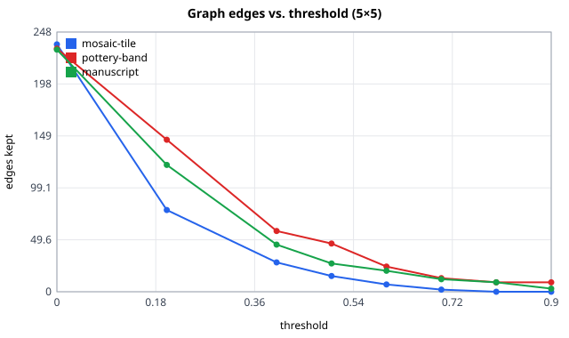

### BFS / DFS scaling (seeded random graphs)

Random graphs with V nodes and average degree d (E = V·d/2); first the V sweep at d = 6, then the d sweep at V = 8,000. `edge_visits` is the engine's own operation counter; time is the best of 5 runs of the traversal alone (graph already built), neighbours sorted by weight as in production.

| V | E | V + E | BFS edge_visits | BFS ms | DFS edge_visits | DFS ms |
|---|---|---|---|---|---|---|
| 1,000 | 3,000 | 4,000 | 6,000 | 0.85 | 6,000 | 1.00 |
| 2,000 | 6,000 | 8,000 | 12,000 | 1.83 | 12,000 | 2.02 |
| 4,000 | 12,000 | 16,000 | 24,000 | 3.82 | 24,000 | 4.11 |
| 8,000 | 8,000 | 16,000 | 16,000 | 4.06 | 16,000 | 4.26 |
| 8,000 | 16,000 | 24,000 | 32,000 | 5.89 | 32,000 | 6.28 |
| 8,000 | 24,000 | 32,000 | 48,000 | 7.70 | 48,000 | 8.77 |
| 8,000 | 32,000 | 40,000 | 64,000 | 9.75 | 64,000 | 10.76 |
| 16,000 | 48,000 | 64,000 | 96,000 | 17.46 | 96,000 | 19.23 |
| 8,000 | 64,000 | 72,000 | 128,000 | 19.86 | 128,000 | 22.13 |
| 32,000 | 96,000 | 128,000 | 192,000 | 42.79 | 192,000 | 46.48 |
| 8,000 | 128,000 | 136,000 | 256,000 | 47.50 | 256,000 | 52.01 |
| 64,000 | 192,000 | 256,000 | 384,000 | 90.17 | 384,000 | 95.78 |

Least-squares fits over all rows (x = V + E):

| quantity | slope | intercept | R² |
|---|---|---|---|
| BFS edge_visits | 1.569 per (V+E) | 739.62 | 0.9831 |
| DFS edge_visits | 1.569 per (V+E) | 739.62 | 0.9831 |
| BFS time | 359.149 ms per 10⁶ (V+E) | -2.85 | 0.9955 |
| DFS time | 383.671 ms per 10⁶ (V+E) | -2.71 | 0.9962 |

Exactly 2E adjacency entries are scanned: BFS edge_visits vs E has slope 2.000, R² 1.0000.

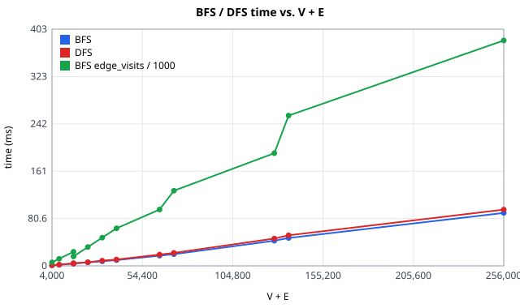

### Extra space: BFS queue vs. DFS stack (peak entries)

Measured with instrumented copies of the engine traversals (the DFS copy is asserted to produce the engine's exact visit order). A node can be pushed on the DFS stack once per incident edge before it is popped, so the stack is bounded by O(E), while the BFS queue holds each node at most once, O(V).

| graph | V | E | BFS queue peak | DFS stack peak | DFS peak / E |
|---|---|---|---|---|---|
| complete K8 | 8 | 28 | 7 | 22 | 0.79 |
| complete K16 | 16 | 120 | 15 | 106 | 0.88 |
| complete K32 | 32 | 496 | 31 | 466 | 0.94 |
| complete K64 | 64 | 2,016 | 63 | 1,954 | 0.97 |
| random d=6, V=1,000 | 1,000 | 3,000 | 536 | 2,090 | 0.70 |
| random d=6, V=64,000 | 64,000 | 192,000 | 34,156 | 133,402 | 0.69 |
<!-- T14:end -->

<!-- T15:begin (generated by run_benchmarks.py) -->

## Greedy and best-first (T15, `solvers/greedy.py`, `solvers/best_first.py`)

Regenerate with `python validation/run_benchmarks.py --greedy-bf-only`. Accuracies and operation counts are deterministic (fixed seeds); `ms` is the solver alone, single run, mean over instances, and varies by machine. No rotation. Each cell is the mean over the 3 samples × seeds [1, 2, 3]. `best_first` uses the full graph (threshold 0, no top-k), which is what the API does by default; `best_first top-3` prunes the graph with mutual top-3 first.

### clean: accuracy, time, operations vs. n

| n | greedy nbr / direct acc. | greedy ms | greedy score_lookups | best_first nbr / direct acc. | best_first ms | heap_pushes | heap_pops | top-3 nbr acc. | top-3 ms | top-3 pushes |
|---|---|---|---|---|---|---|---|---|---|---|
| 4 | 100% / 100% | 0.06 | 22 | 100% / 100% | 0.02 | 6 | 6 | 100% | 0.02 | 6 |
| 9 | 89% / 89% | 0.25 | 216 | 89% / 89% | 0.08 | 36 | 36 | 89% | 0.06 | 12 |
| 16 | 100% / 100% | 0.78 | 914 | 100% / 100% | 0.14 | 113 | 113 | 100% | 0.10 | 21 |
| 25 | 91% / 86% | 2.26 | 3,072 | 82% / 79% | 0.32 | 234 | 234 | 75% | 0.35 | 23 |
| 36 | 87% / 85% | 5.12 | 7,263 | 87% / 85% | 0.49 | 373 | 373 | 83% | 0.58 | 38 |
| 49 | 97% / 95% | 11.68 | 17,532 | 89% / 88% | 0.81 | 579 | 579 | 85% | 1.10 | 53 |
| 64 | 81% / 76% | 21.22 | 33,097 | 73% / 63% | 1.43 | 796 | 796 | 67% | 2.55 | 55 |

### damaged (noise 4, erosion 0.3): accuracy, time, operations vs. n

| n | greedy nbr / direct acc. | greedy ms | greedy score_lookups | best_first nbr / direct acc. | best_first ms | heap_pushes | heap_pops | top-3 nbr acc. | top-3 ms | top-3 pushes |
|---|---|---|---|---|---|---|---|---|---|---|
| 4 | 100% / 100% | 0.05 | 22 | 100% / 100% | 0.02 | 6 | 6 | 100% | 0.02 | 6 |
| 9 | 86% / 86% | 0.23 | 205 | 93% / 93% | 0.07 | 36 | 36 | 88% | 0.07 | 10 |
| 16 | 91% / 92% | 0.80 | 968 | 91% / 92% | 0.15 | 112 | 112 | 90% | 0.12 | 19 |
| 25 | 91% / 85% | 2.31 | 3,108 | 84% / 80% | 0.30 | 233 | 233 | 68% | 0.45 | 20 |
| 36 | 89% / 83% | 5.30 | 7,660 | 85% / 80% | 0.49 | 385 | 385 | 76% | 0.71 | 35 |
| 49 | 85% / 82% | 11.85 | 17,125 | 82% / 77% | 0.86 | 594 | 594 | 54% | 2.26 | 28 |
| 64 | 75% / 70% | 22.96 | 36,395 | 57% / 47% | 2.84 | 818 | 818 | 46% | 4.07 | 40 |

### Best-first on the unpruned graph: pushes vs. edges, conflicts and fallbacks (damaged (noise 4, erosion 0.3))

Each undirected edge is pushed at most once (by whichever endpoint is committed first), so pushes ≤ E. The few missing pushes belong to fragments placed by fallback, which push nothing.

| n | E (graph edges) | heap_pushes | conflicts | fallbacks |
|---|---|---|---|---|
| 9 | 36 | 36 | 1.9 | 0.1 |
| 16 | 112 | 112 | 4.3 | 0.1 |
| 25 | 233 | 233 | 18.6 | 0.3 |
| 36 | 386 | 385 | 31.8 | 0.6 |
| 49 | 595 | 594 | 80.6 | 1.2 |
| 64 | 822 | 818 | 197.7 | 3.2 |

### Fitted growth: log y vs. log n, damaged (noise 4, erosion 0.3), n = 9…64 fragments

Slope of the least-squares line through log(mean y) against log(n); an O(n^p) algorithm gives p (`n log n` appears as a slope slightly above 1).

| quantity | slope p | R² |
|---|---|---|
| greedy score_lookups | 2.62 | 0.9998 |
| greedy time | 2.35 | 0.9991 |
| best_first heap_pushes | 1.58 | 0.9917 |
| best_first heap_pops | 1.58 | 0.9917 |
| best_first time | 1.73 | 0.9487 |
| best_first top-3 heap_pushes | 0.66 | 0.8989 |
| best_first top-3 time | 2.16 | 0.9727 |

### Greedy vs. best-first as noise and erosion rise (5×5 = 25 fragments)

Neighbour accuracy, mean over samples × seeds; the last column is the largest gap on a single instance in best-first's favour (0 or below = greedy was never behind).

| noise | erosion | greedy | best_first | best_first top-3 | worst case: best_first − greedy |
|---|---|---|---|---|---|
| 0 | 0 | 90.6% | 81.9% | 75.3% | +0.0% |
| 4 | 0.3 | 91.1% | 84.2% | 67.5% | +10.0% |
| 8 | 0.3 | 87.8% | 80.8% | 65.6% | +0.0% |
| 16 | 0.3 | 80.3% | 81.7% | 55.3% | +27.5% |
| 16 | 0.6 | 61.1% | 55.3% | 35.0% | +15.0% |
| 32 | 0.6 | 56.4% | 45.8% | 33.9% | +5.0% |

Chart x-axis: row index of this table (0 = clean … 5 = noise 32, erosion 0.6).

### Optimality on tiny grids (exhaustive search, no rotation)

Random symmetric compat tables (random weights on random side pairs); the optimum is the best of all assignments of fragments to cells.

| grid | tables | greedy reaches optimum | best_first reaches optimum | greedy mean score / optimum | best_first mean score / optimum |
|---|---|---|---|---|---|
| 2×2 | 300 | 48% | 33% | 0.892 | 0.796 |
| 2×3 | 300 | 25% | 10% | 0.873 | 0.748 |

**Counterexample where greedy fails** (the instance written out in docs/ALGORITHMS.md §10; fragments A–D, 2×2):

| solver | total score | layout (row-major) |
|---|---|---|
| greedy | 1.05 | C D / B A |
| best_first | 1.05 | C D / B A |
| optimum (exhaustive) | 1.40 | D A / C B |

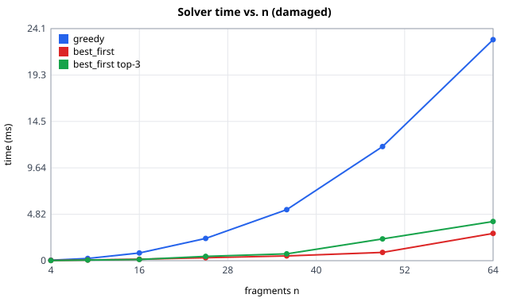

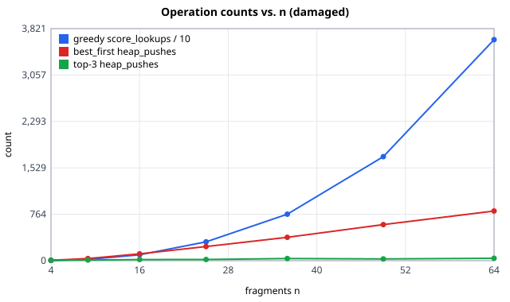

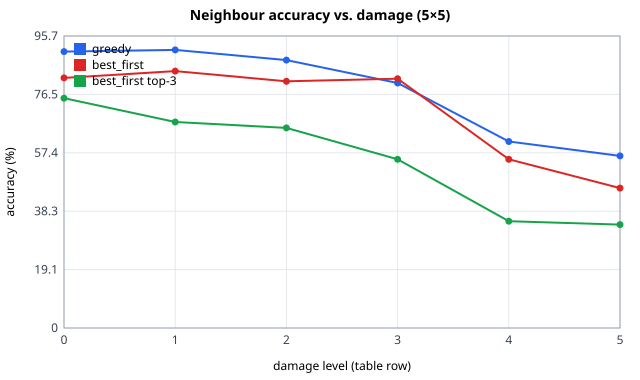

<!-- T15:end -->

<!-- T16:begin (generated by run_benchmarks.py) -->

## Dijkstra (T16, `solvers/dijkstra.py`)

Regenerate with `python validation/run_benchmarks.py --dijkstra-only`. Accuracies and counts are deterministic (fixed seeds); `ms` is the solver alone, single run, and varies by machine. No rotation. Each cell is the mean over the 3 samples × seeds [1, 2, 3]. `dijkstra top-3` is how the API runs it (mutual top-3 graph); `dijkstra full` uses the unpruned graph, like `best_first`.

### clean: accuracy, time, operations vs. n (Dijkstra, full graph)

| n | E | heap_pops | relaxations (2E?) | score_lookups | conflicts | unreachable | nbr / direct acc. | ms |
|---|---|---|---|---|---|---|---|---|
| 4 | 6 | 5 | 12 | 1 | 0.3 | 0.0 | 100% / 100% | 0.02 |
| 9 | 36 | 15 | 72 | 4 | 1.0 | 0.0 | 89% / 89% | 0.08 |
| 16 | 113 | 32 | 225 | 25 | 4.0 | 0.0 | 90% / 94% | 0.21 |
| 25 | 234 | 50 | 468 | 104 | 11.1 | 0.0 | 62% / 64% | 0.57 |
| 36 | 373 | 78 | 747 | 260 | 20.3 | 0.0 | 46% / 45% | 1.33 |
| 49 | 580 | 117 | 1,159 | 396 | 24.3 | 0.0 | 51% / 51% | 2.31 |
| 64 | 797 | 157 | 1,594 | 731 | 37.1 | 0.0 | 38% / 28% | 4.35 |

### damaged (noise 4, erosion 0.3): accuracy, time, operations vs. n (Dijkstra, full graph)

| n | E | heap_pops | relaxations (2E?) | score_lookups | conflicts | unreachable | nbr / direct acc. | ms |
|---|---|---|---|---|---|---|---|---|
| 4 | 6 | 5 | 12 | 1 | 0.3 | 0.0 | 100% / 100% | 0.02 |
| 9 | 36 | 11 | 72 | 18 | 3.8 | 0.0 | 73% / 79% | 0.11 |
| 16 | 112 | 21 | 224 | 63 | 8.1 | 0.0 | 69% / 76% | 0.30 |
| 25 | 233 | 42 | 466 | 173 | 16.3 | 0.0 | 38% / 38% | 0.72 |
| 36 | 386 | 54 | 771 | 389 | 27.4 | 0.0 | 32% / 29% | 1.59 |
| 49 | 595 | 83 | 1,190 | 624 | 37.7 | 0.0 | 29% / 25% | 2.89 |
| 64 | 822 | 110 | 1,644 | 963 | 49.1 | 0.0 | 25% / 19% | 5.08 |

### Fitted growth, damaged (noise 4, erosion 0.3), n = 9…64 fragments (Dijkstra, full graph)

Slope of log(mean y) against log(n) with R². Relaxations are compared with 2E: the ratio is relaxations / (2E), where E is the number of edges of the graph Dijkstra ran on.

| quantity | slope p | R² |
|---|---|---|
| heap_pops | 1.18 | 0.9944 |
| relaxations | 1.58 | 0.9919 |
| score_lookups (fallbacks) | 2.06 | 0.9952 |
| time | 1.95 | 0.9984 |
| E (graph edges) | 1.58 | 0.9919 |

relaxations / 2E = 1.00…1.00; heap_pops / E = 0.13…0.30 (pops = V settles + stale entries, bounded by 1 + the number of improving relaxations ≤ 1 + 2E).

### Dijkstra vs. best-first vs. greedy as noise and erosion rise (5×5 = 25 fragments)

Neighbour accuracy, mean over samples × seeds; conflicts are Dijkstra's per run (a child whose parent cell was taken); the last two columns compare the **tree**: mean join weight of Dijkstra's shortest-path tree against the maximum spanning tree (Prim's target), and the share of fragments whose Dijkstra parent differs from the maximum-spanning-tree parent.

| noise | erosion | greedy | best_first | dijkstra top-3 | dijkstra full | conflicts (full) | mean tree edge: Dijkstra / max spanning tree | parent differs |
|---|---|---|---|---|---|---|---|---|
| 0 | 0 | 90.6% | 81.9% | 79.4% | 62.5% | 11.1 | 0.703 / 0.820 | 40% |
| 4 | 0.3 | 91.1% | 84.2% | 49.4% | 37.8% | 16.3 | 0.517 / 0.685 | 62% |
| 8 | 0.3 | 87.8% | 80.8% | 50.8% | 37.8% | 16.1 | 0.482 / 0.656 | 61% |
| 16 | 0.3 | 80.3% | 81.7% | 50.0% | 34.2% | 17.8 | 0.393 / 0.594 | 77% |
| 16 | 0.6 | 61.1% | 55.3% | 30.6% | 28.3% | 20.2 | 0.318 / 0.512 | 79% |
| 32 | 0.6 | 56.4% | 45.8% | 22.8% | 26.4% | 21.1 | 0.285 / 0.442 | 79% |

Chart x-axis: row index of this table (0 = clean … 5 = noise 32, erosion 0.6).

### Accuracy vs. n, side by side (damaged)

| n | greedy | best_first | dijkstra top-3 | dijkstra full |
|---|---|---|---|---|
| 4 | 100% | 100% | 100% | 100% |
| 9 | 86% | 93% | 86% | 73% |
| 16 | 91% | 91% | 73% | 69% |
| 25 | 91% | 84% | 49% | 38% |
| 36 | 89% | 85% | 59% | 32% |
| 49 | 85% | 82% | 39% | 29% |
| 64 | 75% | 57% | 36% | 25% |

**Counterexample (docs/ALGORITHMS.md §12; fragments A, B, C in a 2×2 grid, seed A):**

Dijkstra settles A (dist 0.00), C (dist 0.65), B (dist 0.75); B's parent is A (Prim's: C).

| solver | total score | layout (row-major) |
|---|---|---|
| dijkstra | 0.60 | . C / B A |
| best_first | 0.95 | C B / A . |
| optimum (exhaustive) | 0.95 | |

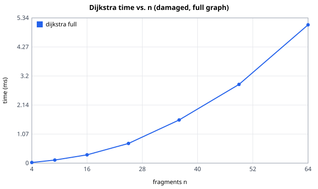

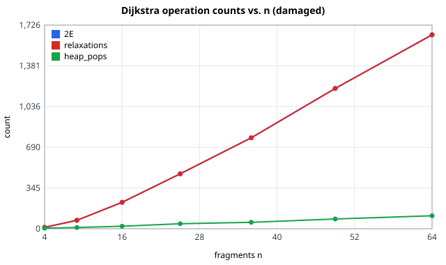

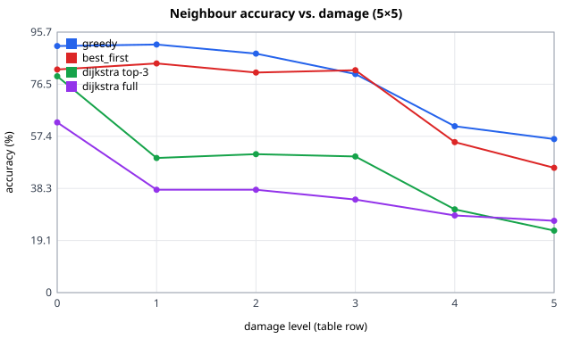

<!-- T16:end -->

<!-- T17:begin (generated by run_benchmarks.py) -->

## Backtracking + branch and bound, and the row DP (T17, `solvers/backtracking.py`, `solvers/row_dp.py`)

Regenerate with `python validation/run_benchmarks.py --backtracking-only`. Node counts, scores and accuracies are deterministic (fixed seeds); `ms` varies by machine. Node limit for this section: **300,000**. A run is *truncated* (marked **\***) when it hit the limit; it then returns the best layout found so far.

### A. Node count vs n (random tables, 2×k grid, density 0.35, mean over 5 seeds)

| n | cells | unbounded tree | nodes, no incumbent | pruned | ms | nodes, greedy incumbent | pruned | ms | truncated (no inc. / inc.) |
|---|---|---|---|---|---|---|---|---|---|
| 4 | 4 | 65 | 54 | 10 | 0.2 | 50 | 11 | 0.1 | 0/5 / 0/5 |
| 6 | 6 | 1,957 | 945 | 506 | 2.4 | 878 | 498 | 2.3 | 0/5 / 0/5 |
| 8 | 8 | 109,601 | 25,441 | 16,751 | 68.6 | 25,304 | 16,707 | 68.5 | 0/5 / 0/5 |
| 10 | 10 | 9,864,101 | 300,001* | 218,349 | 849.7 | 300,001* | 221,734 | 851.1 | 5/5 / 5/5 |
| 12 | 12 | 1,302,061,345 | 300,001* | 227,636 | 880.2 | 300,001* | 229,109 | 883.1 | 5/5 / 5/5 |

- no incumbent: ln(nodes) vs n over n = 4…8 (3 un-truncated sizes): slope **1.540** (each extra fragment multiplies the search by ×4.66), R² = 0.998.
- greedy incumbent: ln(nodes) vs n over n = 4…8 (3 un-truncated sizes): slope **1.556** (each extra fragment multiplies the search by ×4.74), R² = 0.998.
- Smallest n where at least one no-incumbent run was truncated: 10.

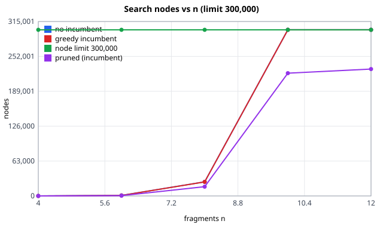

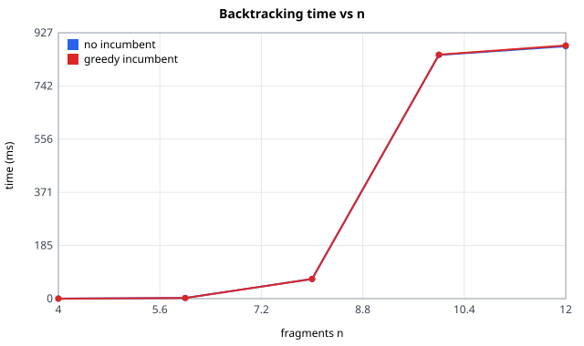

### B. Backtracking vs greedy on synthetic images (mean over 3 samples × seeds [1, 2], no rotation)

`score gap` = backtracking total score − greedy total score (≥ 0 always, because greedy is the incumbent). Accuracy is neighbour / direct against the known truth. **\*** = at least one run truncated.

**clean**

| n | greedy score | backtracking score | score gap | greedy nbr / direct | backtracking nbr / direct | nodes (inc.) | truncated runs | improved on greedy |
|---|---|---|---|---|---|---|---|---|
| 4 | 2.814 | 2.814 | +0.000 | 100% / 100% | 100% / 100% | 10 | 0/6 | 0/6 |
| 9 | 7.395 | 7.603 | +0.208 | 89% / 89% | 100% / 100% | 367 | 0/6 | 2/6 |
| 16 | 17.530 | 17.530 | +0.000 | 100% / 100% | 100% / 100% | 1,886 | 0/6 | 0/6 |

**damaged (noise 4, erosion 0.3)**

| n | greedy score | backtracking score | score gap | greedy nbr / direct | backtracking nbr / direct | nodes (inc.) | truncated runs | improved on greedy |
|---|---|---|---|---|---|---|---|---|
| 4 | 2.464 | 2.464 | +0.000 | 100% / 100% | 100% / 100% | 12 | 0/6 | 0/6 |
| 9 | 5.833 | 5.983 | +0.150 | 94% / 94% | 100% / 100% | 684 | 0/6 | 1/6 |
| 16 | 12.325 | 12.504 | +0.179 | 87% / 89% | 90% / 91% | 106,158* | 2/6 | 1/6 |

### C. Row-profile DP vs backtracking on 2×c strips (random tables, density 0.35, seed 7, no rotation)

DP state limit for this table: 1,500,000 stored states (`solve_row_dp(max_states=…)`). `transitions` counts DP edge relaxations; backtracking `nodes` is with the greedy incumbent and limit 300,000. Scores agree whenever backtracking is not truncated.

| c | fragments | DP states stored | DP transitions | DP ms | backtracking nodes | backtracking ms | DP score | backtracking score |
|---|---|---|---|---|---|---|---|---|
| 2 | 4 | 24 | 48 | 0 | 56 | 0 | 1.734 | 1.734 |
| 3 | 6 | 240 | 960 | 0 | 1,305 | 3 | 3.223 | 3.223 |
| 4 | 8 | 1,792 | 10,752 | 3 | 36,672 | 101 | 5.325 | 5.325 |
| 5 | 10 | 11,520 | 92,160 | 29 | 300,001* | 859 | 7.338 | 6.942 |
| 6 | 12 | 67,584 | 675,840 | 214 | 300,001* | 887 | 10.188 | 9.635 |
| 7 | 14 | 372,736 | 4,472,832 | 1415 | 300,001* | 905 | 12.307 | 11.200 |
| 8 | 16 | — (row DP state limit exceeded (1,703,760 > 1,500,000); use fewer columns) | — | — | 300,001* | 902 | — | 12.849 |

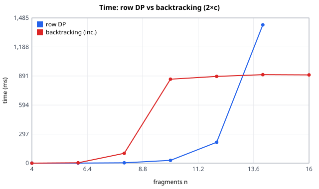

<!-- T17:end -->
